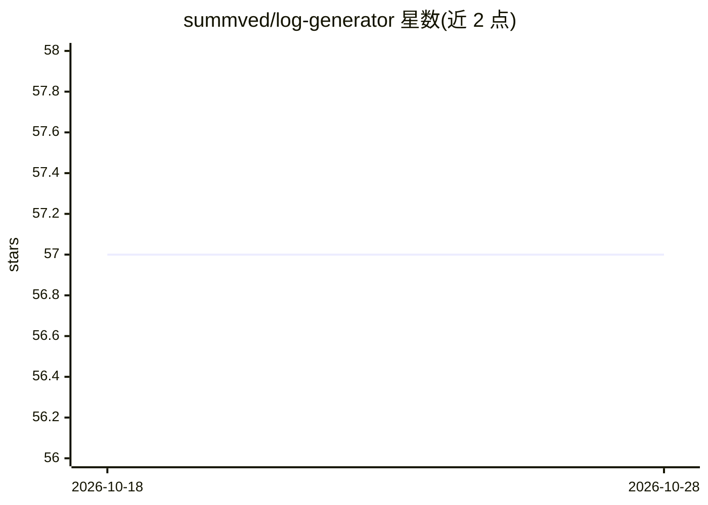

# summved/log-generator

⭐ 57 · TypeScript · NOASSERTION · 推送 2026-10-21 · [GitHub](https://github.com/summved/log-generator) · 个人维护

**面向 SIEM 测试的本地合成日志生成 CLI（含 ML 分析）**

TypeScript/Node.js 命令行工具，本地生成 12 类来源的高流量合成日志，自动映射 MITRE ATT&CK 技战术并支持过滤，报告 D3FEND 覆盖，内置 APT29、Ryuk、内部人员窃取 3 套攻击链模板。输出 json/syslog/cef/wazuh 格式，可发往文件、HTTP（Splunk HEC/Elasticsearch bulk）、syslog 与 stdout。附带 Node-only ML：行为画像学习、异常检测、量级预测、IOC 提取与朴素贝叶斯分类器，不依赖 Python、transformers、GPU 或模型下载；README 明确所谓 AI 模式仅做时序扰动，无模型参与。多线程生成经基准测量达数十万条/秒。限非商业使用，商用需另行授权。

## 筛选速览

| 维度 | 判定 | 备注 |
|---|---|---|
| AI 角色 | `ai-enhanced` | 去掉 AI 部分产品仍成立 |
| 许可风险 | `none` | NOASSERTION |
| 部署形态 | `library` | 以包/库形式分发 |
| 模型依赖 | — | README 未给出锁定关系 |
| 硬件要求 | — | 无带数字的原话,不猜 |
| 安装摩擦 | `low` | 无编译、无系统依赖或容器化 |
| 成熟度 | — | 结构信号不足 |

## 能力要点

- 12 类日志源生成，速率由配置驱动，worker 多线程分流
- MITRE ATT&CK 自动打标/过滤与 D3FEND 覆盖报告
- 3 套 MITRE 标注攻击链模板（APT29/Ryuk/内部窃取）
- Node-only ML：异常检测、量级预测、IOC 提取、朴素贝叶斯分类，无 Python/GPU/模型下载

## 适用场景

- 为 SIEM 检测工程提供可复现的多源测试日志
- 安全培训中构造带 MITRE 标注的攻击链场景
- 对日志处理系统做一致的负载与吞吐测试

## 场景标签

`网络安全` · 领域:学习与行业

## 证据(README 行号)

> L15: - **Honest "AI" variation** — the AI-enhanced modes vary each step's timing, delay, and log rate (±10–50%) only. Th
> L16: - **Node-only ML** — learn a behavioral profile and generate from it, plus anomaly detection (volume z-scores, isol
> L114: - **Node.js >= 22.12** (see `engines` in `package.json`).

## 星数曲线

2026-10-18 57 → 2026-10-28 57（+0）

---
*卡片 v1 · prompt 1.4 · 生成 2026-10-24 · 置信度 high · 依据 README sha `88d21430f73c` · [字段定义](../../DATASET.md)*
