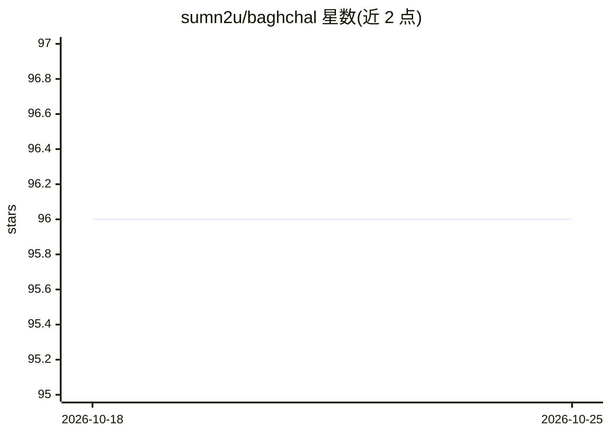

# sumn2u/baghchal

⭐ 96 · JavaScript · BSD-3-Clause · 推送 2025-12-30 · [GitHub](https://github.com/sumn2u/baghchal) · [官网](https://sumn2u.github.io/baghchal/) · 个人维护

**尼泊尔传统棋类 Bagh-Chal 的开源网页版：虎猎羊非对称对战**

源自尼泊尔的传统双人不对称棋盘游戏 Bagh-Chal 的开源实现：四只虎通过跳吃猎捕山羊，山羊方则通过围堵限制虎的移动，双方胜利条件不同。提供人机对战（AI）与基于 Socket.io 的多人对战，含多个游戏关卡、音效设置与双方操作说明。以 HTML5/CSS3/Vanilla JavaScript 构建，Webpack 5 打包，Node.js/Express 后端；通过 git clone 与 yarn 安装运行，另有 Android、iOS 与网页在线版本。

## 筛选速览

| 维度 | 判定 | 备注 |
|---|---|---|
| AI 角色 | `ai-enhanced` | 去掉 AI 部分产品仍成立 |
| 许可风险 | `permissive` | BSD-3-Clause |
| 部署形态 | `None` |  |
| 模型依赖 | — | README 未给出锁定关系 |
| 硬件要求 | — | 无带数字的原话,不猜 |
| 安装摩擦 | `low` | 无编译、无系统依赖或容器化 |
| 成熟度 | — | 结构信号不足 |

## 能力要点

- 虎羊双方非对称胜利条件的规则实现
- 基于 Socket.io 的多人联网对战
- 含 AI 对手、多关卡与音效设置
- 提供 Web/Android/iOS 三端版本

## 适用场景

- 在线体验或本地运行 Bagh-Chal 传统棋类
- 与 AI 或其他玩家进行虎羊对战
- 了解传统棋类游戏的网页实现方式

## 场景标签

 · 领域:游戏/娱乐

## 证据(README 行号)

> L8: **Bagh-Chal** (बाघ चाल) is a traditional strategic board game that originated in Nepal. The name translates to "Tige
> L22: This project was initially built for Community Challenge hackathon by Facebook Developers Community and submitted a

## 星数曲线

2026-10-18 96 → 2026-10-25 96（+0）

---
*卡片 v1 · prompt 1.4 · 生成 2026-10-23 · 置信度 high · 依据 README sha `422cc3fe19ec` · [字段定义](../../DATASET.md)*
