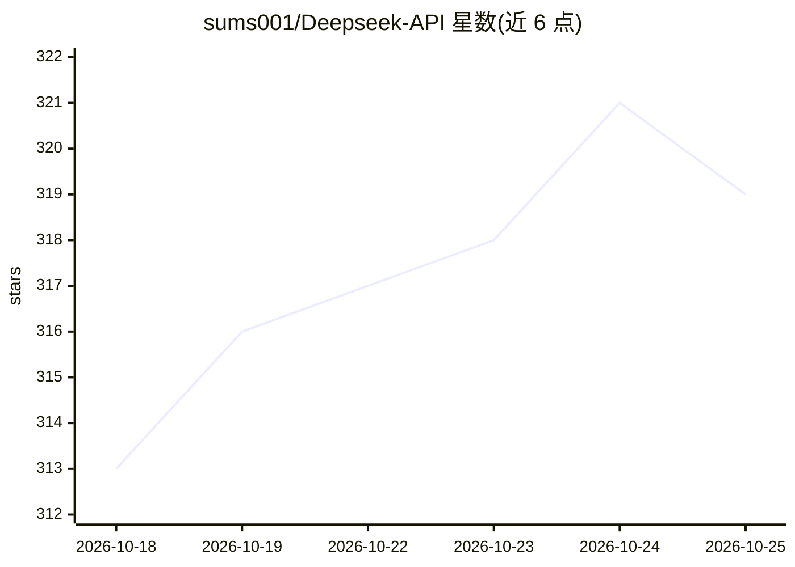

# sums001/Deepseek-API

⭐ 321 · Python · MIT · 推送 2026-06-30 · [GitHub](https://github.com/sums001/Deepseek-API) · 个人维护

**将 DeepSeek 网页聊天封装成 OpenAI 兼容本地 API 的桥梁**

逆向工程 chat.deepseek.com 的非官方项目：用用户自己的免费 DeepSeek 账号登录，把网页聊天转为可编程接口。提供两种形态——Python 库（DeepSeekClient，支持流式与多轮对话）和运行在 localhost:8000 的 OpenAI 兼容 FastAPI 服务器，官方 openai SDK 可直接指向使用。自动处理 AWS WAF 人机验证与 PoW 挑战（在 wasmtime 沙箱内运行 DeepSeek 的 wasm 模块）。限制：单账号串行无并发、请求按 IP 限流、多数 OpenAI 参数被忽略、不支持视觉。

## 筛选速览

| 维度 | 判定 | 备注 |
|---|---|---|
| AI 角色 | `ai-ecosystem` | LLM/agent 周边工具 |
| 许可风险 | `permissive` | MIT |
| 部署形态 | `desktop` | 安装包/桌面程序 |
| 模型依赖 | locked-api |  |
| 硬件要求 | — | 无带数字的原话,不猜 |
| 安装摩擦 | `low` | 无编译、无系统依赖或容器化 |
| 成熟度 | — | 结构信号不足 |

## 能力要点

- Python 库与 OpenAI 兼容本地服务器两种使用方式
- 自动处理人机验证与 PoW 挑战，会话缓存约 6 小时并自动刷新
- 支持流式输出、多轮对话、DeepThink 推理与联网搜索开关
- 依赖项内置滑动窗口限流（默认 30 请求/分钟/IP）

## 适用场景

- 在没有 API 付费预算时用代码调用 DeepSeek 模型
- 让现有 OpenAI SDK 应用零改动切换到本地 DeepSeek 接口
- 个人项目中获得流式与多轮对话能力

## 场景标签

`模型网关` · 领域:Agent 开发

## 证据(README 行号)

> L8: - 🔌 **As a local OpenAI-compatible API:** runs a server at `http://localhost:8000/v1` that speaks the OpenAI format,
> L88: python app.py

## 星数曲线

2026-10-18 313 → 2026-10-25 319（+6）

---
*卡片 v1 · prompt 1.4 · 生成 2026-10-21 · 置信度 mid · 依据 README sha `da378dee0942` · [字段定义](../../DATASET.md)*
