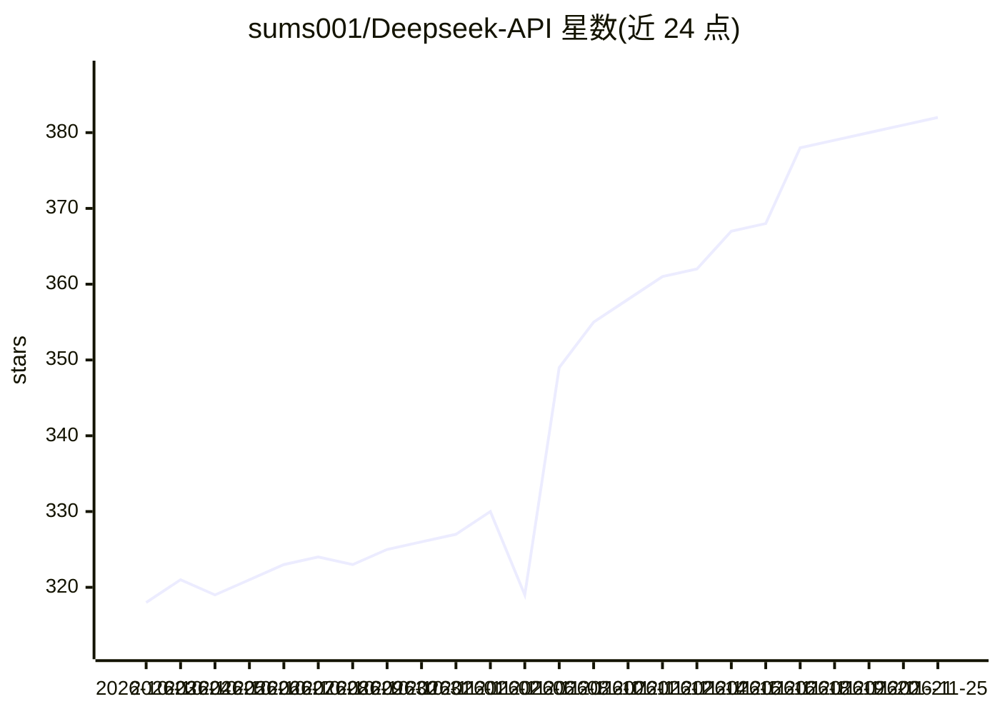

# sums001/Deepseek-API

⭐ 382 · Python · MIT · 推送 2026-10-30 · [GitHub](https://github.com/sums001/Deepseek-API) · 个人维护

**把 DeepSeek 网页聊天转为本地 OpenAI 兼容 API**

逆向工程 chat.deepseek.com 的免费网页聊天，将其封装为可编程访问的接口：既可作为 Python 库（chat/stream 方法、多轮会话），也可启动 FastAPI 服务器暴露 OpenAI 格式的 /v1/chat/completions 端点，官方 openai SDK 无需改动即可指向 localhost 使用。自动处理 AWS WAF 人机验证与 PoW 挑战（wasmtime 沙箱运行官方 wasm 模块），浏览器登录一次后会话缓存于 session/ 并自动刷新。限制：上游调用串行、按 IP 自限流、多数 OpenAI 参数被忽略、无视觉能力、需遵守 DeepSeek 条款。

## 筛选速览

| 维度 | 判定 | 备注 |
|---|---|---|
| AI 角色 | `ai-ecosystem` | LLM/agent 周边工具 |
| 许可风险 | `permissive` | MIT |
| 部署形态 | `desktop` | 安装包/桌面程序 |
| 模型依赖 | locked-api |  |
| 硬件要求 | — | 无带数字的原话,不猜 |
| 安装摩擦 | `low` | 无编译、无系统依赖或容器化 |
| 成熟度 | — | 结构信号不足 |

## 能力要点

- OpenAI 兼容本地服务器，官方 openai SDK 可直接指向使用
- 自动处理人机验证与 PoW 挑战，会话缓存并自动刷新
- 支持流式输出、多轮会话、DeepThink 与联网搜索开关
- 提供 Docker Compose 部署与按 IP 滑动窗口限流

## 适用场景

- 让现有 OpenAI 客户端应用直接调用 DeepSeek 模型
- 在 Python 脚本中以库形式调用 DeepSeek 聊天
- 自托管轻量 LLM API 用于个人开发测试

## 场景标签

`模型网关` · 领域:Agent 开发

## 证据(README 行号)

> L8: - 🔌 **As a local OpenAI-compatible API:** runs a server at `http://localhost:8000/v1` that speaks the OpenAI format,
> L83: ## Usage 2: As an OpenAI-compatible server
> L224: |server/|The FastAPI OpenAI-compatible server|

## 星数曲线

2026-10-23 318 → 2026-11-25 382（+64）

---
*卡片 v1 · prompt 1.4 · 生成 2026-11-25 · 置信度 mid · 依据 README sha `d900e80c6e10` · [字段定义](../../DATASET.md)*
