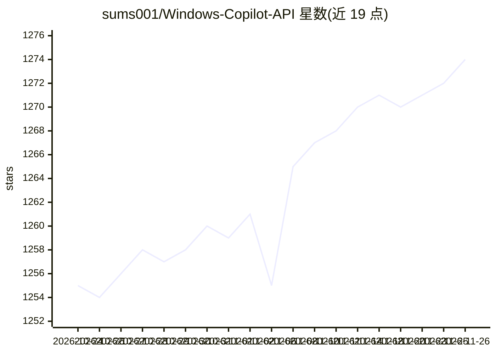

# sums001/Windows-Copilot-API

⭐ 1,274 · Python · MIT · 推送 2026-10-30 · [GitHub](https://github.com/sums001/Windows-Copilot-API) · 个人维护

**将 Windows Copilot 逆向为 OpenAI 兼容 API 的本地桥接服务**

以 Python 库与本地服务器两种形式，把已登录的 copilot.com 网页聊天桥接为 OpenAI 格式的 HTTP 接口：服务器暴露 /v1/chat/completions 与 /v1/models，官方 openai SDK 可直接指向 localhost 使用。登录一次后 token 自动刷新，后续走纯 HTTP；服务器串行处理上游请求，自带令牌桶限速（默认 12 rpm）。为非官方项目，依赖个人账户，仅支持文本、单一模型，日用量受免费额度限制。

## 筛选速览

| 维度 | 判定 | 备注 |
|---|---|---|
| AI 角色 | `ai-ecosystem` | LLM/agent 周边工具 |
| 许可风险 | `permissive` | MIT |
| 部署形态 | `desktop` | 安装包/桌面程序 |
| 模型依赖 | — | README 未给出锁定关系 |
| 硬件要求 | — | 无带数字的原话,不猜 |
| 安装摩擦 | `low` | 无编译、无系统依赖或容器化 |
| 成熟度 | — | 结构信号不足 |

## 能力要点

- 提供 Python 库（client.chat/stream）与 OpenAI 兼容本地服务器两种用法
- 浏览器登录一次后 token 自动刷新，后续无需浏览器
- 内置并发压测、限速调节与诊断报告工具
- 支持 Docker 运行，挂载 session 目录保持登录

## 适用场景

- 把已登录的 Copilot 账户当成本地 OpenAI 接口供脚本调用
- 让现有 OpenAI 兼容工具改指 localhost 使用
- 个人低并发（约 1–4 路）聊天请求场景

## 场景标签

`模型网关` · 领域:Agent 开发

## 证据(README 行号)

> L10: - 🔌 **As a local OpenAI-compatible API:** runs a server at `http://localhost:8000/v1` that speaks the OpenAI format
> L133: |`POST`|`/v1/chat/completions`|Chat (supports `"stream": true` and an optional `"conversation_id"`)|
> L238: |server/|The FastAPI OpenAI-compatible server|

## 星数曲线

2026-10-24 1,255 → 2026-11-26 1,274（+19）

---
*卡片 v1 · prompt 1.4 · 生成 2026-11-23 · 置信度 mid · 依据 README sha `e08f2952175b` · [字段定义](../../DATASET.md)*
