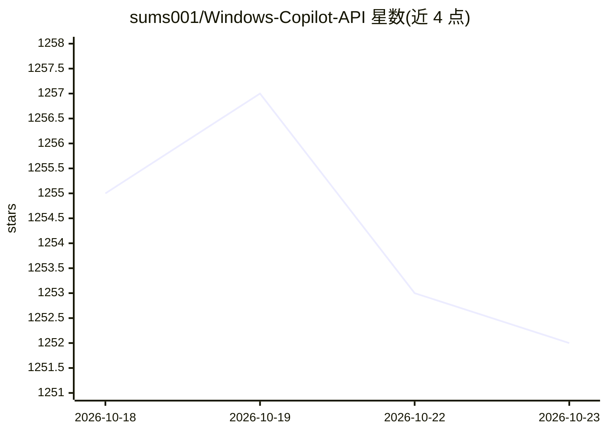

# sums001/Windows-Copilot-API

⭐ 1,252 · Python · MIT · 推送 2026-06-27 · [GitHub](https://github.com/sums001/Windows-Copilot-API) · 个人维护

**将 Microsoft Copilot 网页版逆向封装为 OpenAI 兼容本地 API**

非官方项目，把个人 Microsoft Copilot 免费网页聊天账户逆向为可编程接口：以 Python 库（CopilotClient，支持流式与多轮对话）或本地 FastAPI 服务器（http://localhost:8000/v1，OpenAI 兼容格式）两种方式使用，官方 openai SDK 可直接指向 localhost。需用 Microsoft 或 Google 账户浏览器登录一次，session 保存于本地并自动刷新；自动处理 Cloudflare 人机验证（约 30 分钟过期）。限制：单账户、请求串行执行（实测最高并发 4）、默认限速 12 rpm、仅暴露单一 copilot 模型。提供 Docker 运行方式与压力/诊断测试脚本。

## 筛选速览

| 维度 | 判定 | 备注 |
|---|---|---|
| AI 角色 | `ai-ecosystem` | LLM/agent 周边工具 |
| 许可风险 | `permissive` | MIT |
| 部署形态 | `desktop` | 安装包/桌面程序 |
| 模型依赖 | — | README 未给出锁定关系 |
| 硬件要求 | — | 无带数字的原话,不猜 |
| 安装摩擦 | `low` | 无编译、无系统依赖或容器化 |
| 成熟度 | — | 结构信号不足 |

## 能力要点

- 把免费 Copilot 网页账户转为 OpenAI 兼容 API，无需 API key 与计费
- Python 库与 OpenAI 格式本地服务器两种用法，官方 openai SDK 可直连
- 自动处理 Cloudflare cf_clearance 验证与 session 刷新
- 内置并发压力测试、速率限制（令牌桶）与诊断工具

## 适用场景

- 用已有 Copilot 账户在代码中免费调用 LLM
- 让现有 OpenAI SDK/应用不改代码切换到本地 Copilot 端点
- 个人项目或脚本中原型验证 LLM 功能而不产生 API 费用

## 场景标签

 · 领域:LLM 基础设施/API 网关

## 证据(README 行号)

> L10: - 🔌 **As a local OpenAI-compatible API:** runs a server at `http://localhost:8000/v1` that speaks the OpenAI format
> L103: ## Usage 2: As an OpenAI-compatible server

## 星数曲线

2026-10-18 1,255 → 2026-10-23 1,252（-3）

---
*卡片 v1 · prompt 1.4 · 生成 2026-10-21 · 置信度 mid · 依据 README sha `51cea7923e6d` · [字段定义](../../DATASET.md)*
