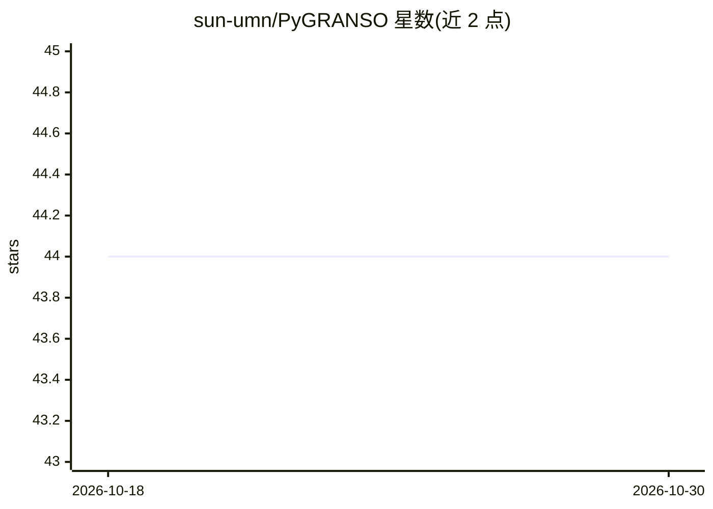

# sun-umn/PyGRANSO

⭐ 44 · Jupyter Notebook · AGPL-3.0 · 推送 2026-05-08 · [GitHub](https://github.com/sun-umn/PyGRANSO) · [官网](https://ncvx.org) · 组织维护

**面向机器学习的非光滑非凸约束优化求解器（PyTorch 版 GRANSO）**

GRANSO 的 PyTorch 移植版 NCVX 初始求解器，用 BFGS-SQP 算法求解带非光滑约束的一般非凸优化问题。相对 MATLAB 原版，纳入自动微分、GPU 加速、张量输入与新 QP 求解器（OSQP，可选 Gurobi），可求解一般约束深度学习问题。面向缺乏优化专业背景的机器学习/深度学习研究者与开发者。需 Python 3.10+，通过源码（uv/pip）安装，许可为 AGPL v3.0 并含少量 GPL 代码。

## 筛选速览

| 维度 | 判定 | 备注 |
|---|---|---|
| AI 角色 | `ai-ecosystem` | LLM/agent 周边工具 |
| 许可风险 | `viral` | AGPL-3.0 |
| 部署形态 | `library` | 以包/库形式分发 |
| 模型依赖 | — | README 未给出锁定关系 |
| 硬件要求 | — | 无带数字的原话,不猜 |
| 安装摩擦 | `medium` | 含编译或系统依赖之一 |
| 成熟度 | — | 结构信号不足 |

## 能力要点

- 求解一般非光滑非凸约束优化问题（BFGS-SQP）
- PyTorch 自动微分、张量输入与 GPU（CUDA）加速
- 支持 OSQP 及可选 Gurobi 作为 QP 求解器
- 声明可求解一般约束深度学习问题

## 适用场景

- 为深度学习模型训练添加显式非光滑约束
- 在 PyTorch 工作流中求解非凸约束优化问题而无需手推梯度
- 复现与 GRANSO/NCVX 相关的优化研究

## 场景标签

 · 领域:数值优化/机器学习

## 证据(README 行号)

> L13: Optimizing nonconvex (NCVX) problems, especially nonsmooth and constrained ones, is an essential part of machine le
> L17: PyGRANSO requires **Python 3.10+** (3.13+ recommended). Dependencies are managed via `pyproject.toml`.

## 星数曲线

2026-10-18 44 → 2026-10-30 44（+0）

---
*卡片 v1 · prompt 1.4 · 生成 2026-10-25 · 置信度 high · 依据 README sha `9e1e4b3d683a` · [字段定义](../../DATASET.md)*
