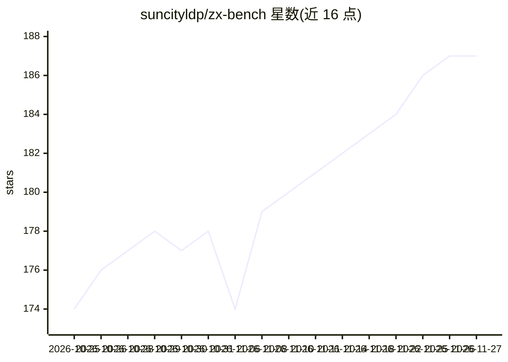

# suncityldp/zx-bench

⭐ 187 · TypeScript · MIT · 推送 2026-10-28 · [GitHub](https://github.com/suncityldp/zx-bench) · 组织维护 · 中文 README

**本地部署的大模型评测平台：题库、评分、报告与排行榜**

ZxBench 是本地部署的大模型评测平台，提供版本化题库（1.60.0，803 道来源题、920 个执行实例）、规则评分加可选 AI Judge、Docker 隔离执行、冻结运行、实时监控与报告排行榜。覆盖编程、幻觉抵抗、推理数学、工具 CLI、agent 工作流等 11 个维度，含多文件编程长任务与渐进式分问试题。部署依赖 Node.js ≥22.13、pnpm、Docker（linux/amd64），使用 SQLite 存储，部署验收阶段不需要模型 API Key。

## 筛选速览

| 维度 | 判定 | 备注 |
|---|---|---|
| AI 角色 | `ai-ecosystem` | LLM/agent 周边工具 |
| 许可风险 | `permissive` | MIT |
| 部署形态 | `desktop` | 安装包/桌面程序 |
| 模型依赖 | — | README 未给出锁定关系 |
| 硬件要求 | — | 无带数字的原话,不猜 |
| 安装摩擦 | `medium` | 含编译或系统依赖之一 |
| 成熟度 | — | 结构信号不足 |

## 能力要点

- 11 个评测维度、803 道来源题与 920 个执行实例的版本化题库
- CLI/脚本题在隔离容器中真实执行，依据输出、文件与工具调用轨迹判分
- 规则评分加可选 Judge，评分失败与环境错误分别留证
- 支持批量评测、实时监控暂停/重试与只读评分核验

## 适用场景

- 在本机对多个本地模型做可复现的横向评测
- 考察模型在容器内执行 CLI 任务和多文件工程改造的能力
- 测试模型长链路故障恢复与渐进式多问推理表现
- 建立团队内部可审计的模型评测报告与排行榜

## 场景标签

`模型评测` · 领域:评测与运维

## 证据(README 行号)

> L1: # ZxBench · 本地大模型评测系统
> L7: ZxBench 是本地部署的大模型评测平台，提供 Docker 执行、规则评分、可选 AI Judge、实时监控、冻结运行、报告和排行榜。当前应用版本 **v0.2.13**；发布题库 **1.60.0** 有 **803 道来源题
> L187: - **真正执行而非只看文字。** CLI/脚本题在隔离容器里运行候选脚本，检查标准输出、产出文件和 Git 工作区状态。工具与智能体题使用可重置的本地模拟世界，依据工具调用轨迹、状态变化、最终结果和禁止副作用判分。

## 星数曲线

2026-10-25 174 → 2026-11-27 187（+13）

---
*卡片 v1 · prompt 1.4 · 生成 2026-11-26 · 置信度 high · 依据 README sha `482f765990f5` · [字段定义](../../DATASET.md)*
