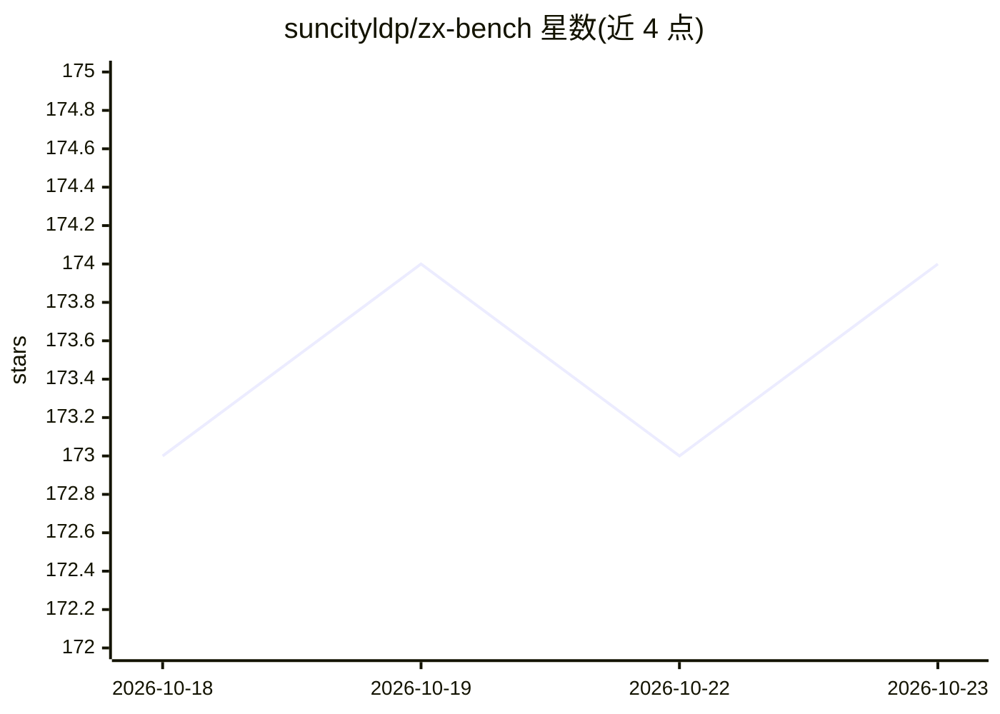

# suncityldp/zx-bench

⭐ 174 · TypeScript · MIT · 推送 2026-10-12 · [GitHub](https://github.com/suncityldp/zx-bench) · 组织维护 · 中文 README

**本地部署的大模型评测平台：版本化题库、确定性评分与可审计报告**

ZxBench 是本地运行的大模型评测系统：发布题库 1.60.0 含 803 道来源题、920 个执行实例，覆盖编程、幻觉抵抗、数学推理、CLI 深度任务等 11 个维度，按难度加权计分。执行类题目在隔离 Docker 容器中运行候选脚本，检查输出、产出文件与工作区状态；评分以规则评分器为主，语义判断可按题型使用可选 AI Judge。支持最多 8 个模型批量评测、实时监控、冻结运行与只读核验（run:verify-score）。部署依赖 Node.js ≥22.13、pnpm 11.21.0 与带 containerd 存储的 Docker 引擎，通过 pnpm 命令安装构建；镜像按固定 digest 拉取并校验。

## 筛选速览

| 维度 | 判定 | 备注 |
|---|---|---|
| AI 角色 | `ai-ecosystem` | LLM/agent 周边工具 |
| 许可风险 | `permissive` | MIT |
| 部署形态 | `desktop` | 安装包/桌面程序 |
| 模型依赖 | — | README 未给出锁定关系 |
| 硬件要求 | — | 无带数字的原话,不猜 |
| 安装摩擦 | `medium` | 含编译或系统依赖之一 |
| 成熟度 | — | 结构信号不足 |

## 能力要点

- 803 道来源题、920 个执行实例，11 维度难度加权计分
- Docker 隔离容器内真实执行 CLI/脚本题并检查副作用
- 规则评分器为主、可选 AI Judge，冲突与失败分别留证
- 冻结运行与 run:verify-score 只读核验，支持离线镜像准备

## 适用场景

- 本地对多个候选模型跑标准化评测并生成排行榜
- 通过容器化执行任务检验模型的工具调用与工程能力
- 对历史运行做只读审计或按需重算评分

## 场景标签

`模型评测` · 领域:评测与运维

## 证据(README 行号)

> L7: ZxBench 是本地部署的大模型评测平台，提供 Docker 执行、规则评分、可选 AI Judge、实时监控、冻结运行、报告和排行榜。当前应用版本 **v0.2.12**；发布题库 **1.60.0** 有 **803 道来源题
> L179: 每题按难度加权（easy 1、medium 1.5、hard 2、adversarial 2.5）；`long_task_*` 编程长任务显式使用 **3.0**。迁移实例先按原来源题取均分，使用来源题原难度和类别权重，再求维度

## 星数曲线

2026-10-18 173 → 2026-10-23 174（+1）

---
*卡片 v1 · prompt 1.4 · 生成 2026-10-22 · 置信度 mid · 依据 README sha `35418063bf44` · [字段定义](../../DATASET.md)*
