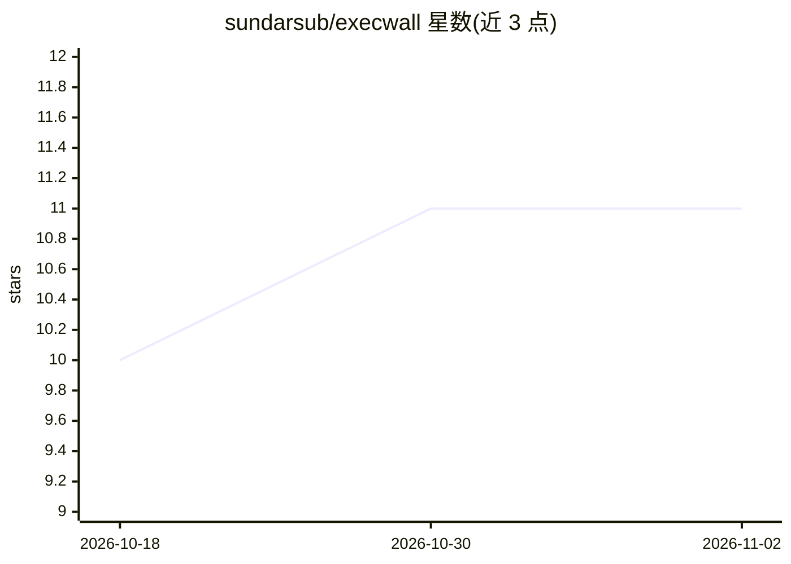

# sundarsub/execwall

⭐ 11 · Rust · Apache-2.0 · 推送 2026-03-01 · [GitHub](https://github.com/sundarsub/execwall) · 个人维护

**AI agent 执行防火墙：策略管控命令与 Python 沙箱隔离**

位于 AI agent（如 OpenClaw）与操作系统之间的执行防火墙，用正则策略规则治理可执行命令，以 Linux namespace、Seccomp-BPF、cgroups v2 隔离不可信 Python 代码。提供交互式 REPL 与 TCP JSON API（端口 9800）双模式，支持按 identity 的差异化策略、审计日志（JSON Lines、SHA256 代码哈希）与速率限制。以二进制 Release 与 install.sh 安装为主，源码构建需 Rust 1.75+ 与 libseccomp-dev，README 给出 Oracle Cloud Free Tier 部署路径与 Docker 部署示例。

## 筛选速览

| 维度 | 判定 | 备注 |
|---|---|---|
| AI 角色 | `ai-ecosystem` | LLM/agent 周边工具 |
| 许可风险 | `permissive` | Apache-2.0 |
| 部署形态 | `self-host` | docker 或自建部署 |
| 模型依赖 | — | README 未给出锁定关系 |
| 硬件要求 | — | 无带数字的原话,不猜 |
| 安装摩擦 | `low` | 无编译、无系统依赖或容器化 |
| 成熟度 | — | 结构信号不足 |

## 能力要点

- Seccomp-BPF 内核级系统调用过滤与 namespace/cgroup 隔离的 Python 沙箱
- 正则规则、首匹配优先的策略引擎，含 audit 模式与 per-identity 速率限制
- TCP JSON API 双模式：沙箱执行 Python 与策略管控的命令执行
- JSON Lines 审计日志，含 SHA256 代码哈希与执行指标

## 适用场景

- 为 AI agent 生成的代码提供受限执行后端
- 按用户/服务维度管控服务器上可执行的命令
- 部署 WhatsApp/Telegram 消息机器人时隔离不可信执行

## 场景标签

`网络安全` · 领域:学习与行业

## 证据(README 行号)

> L14: Execwall is an **execution firewall** for AI agents. It sits between your AI (like OpenClaw) and the operating syst
> L17: - **Seccomp syscall filtering** - Block dangerous operations at the kernel level
> L19: - **Python sandbox isolation** - Namespace + cgroup + seccomp for untrusted code

## 星数曲线

2026-10-18 10 → 2026-11-02 11（+1）

---
*卡片 v1 · prompt 1.4 · 生成 2026-11-01 · 置信度 mid · 依据 README sha `81f1866e6502` · [字段定义](../../DATASET.md)*
