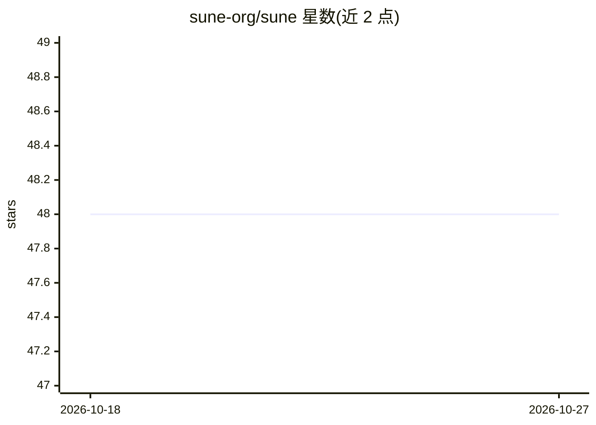

# sune-org/sune

⭐ 48 · JavaScript · NOASSERTION · 推送 2026-10-21 · [GitHub](https://github.com/sune-org/sune) · [官网](https://sune.chat) · 组织维护

**OpenRouter 聊天前端，附 Android 应用与 GitHub 同步**

面向终端用户的 OpenRouter 前端应用，提供 Web 界面与 Android APK，另支持 Gemini、OpenAI、Claude 的 API key。核心机制是 sune 模块化设计：每个 sune 是可分享的模块，可挂载页面脚本以实现函数调用或扩展功能；内置技能市场与 LaTeX 支持。聊天记录可通过 GitHub Personal Access Token 同步到私有或公开仓库（JSON 文件形式），支持跨设备上传/下载备份。

## 筛选速览

| 维度 | 判定 | 备注 |
|---|---|---|
| AI 角色 | `ai-ecosystem` | LLM/agent 周边工具 |
| 许可风险 | `none` | NOASSERTION |
| 部署形态 | `None` |  |
| 模型依赖 | — | README 未给出锁定关系 |
| 硬件要求 | — | 无带数字的原话,不猜 |
| 安装摩擦 | `low` | 无编译、无系统依赖或容器化 |
| 成熟度 | — | 结构信号不足 |

## 能力要点

- OpenRouter 前端 + Android APK，兼容 Gemini/OpenAI/Claude API key
- sune 模块化设计，支持分享与页面脚本扩展
- 内置技能市场与 LaTeX 支持
- 聊天记录通过 GitHub 仓库（PAT + gh:// 协议）跨设备同步

## 适用场景

- 在手机或桌面通过统一界面使用多家模型 API 聊天
- 把聊天记录备份到自己的 GitHub 仓库并跨设备同步
- 通过脚本和市场扩展单个 sune 的功能

## 场景标签

`聊天机器人` · 领域:对话与助手

## 证据(README 行号)

> L1: Download For Android (.apk)-green?style=for-the-badge&logo=android)
> L22: ## 🔄 Sync Your Chats with GitHub

## 星数曲线

2026-10-18 48 → 2026-10-27 48（+0）

---
*卡片 v1 · prompt 1.4 · 生成 2026-10-25 · 置信度 mid · 依据 README sha `b5410459ed08` · [字段定义](../../DATASET.md)*
