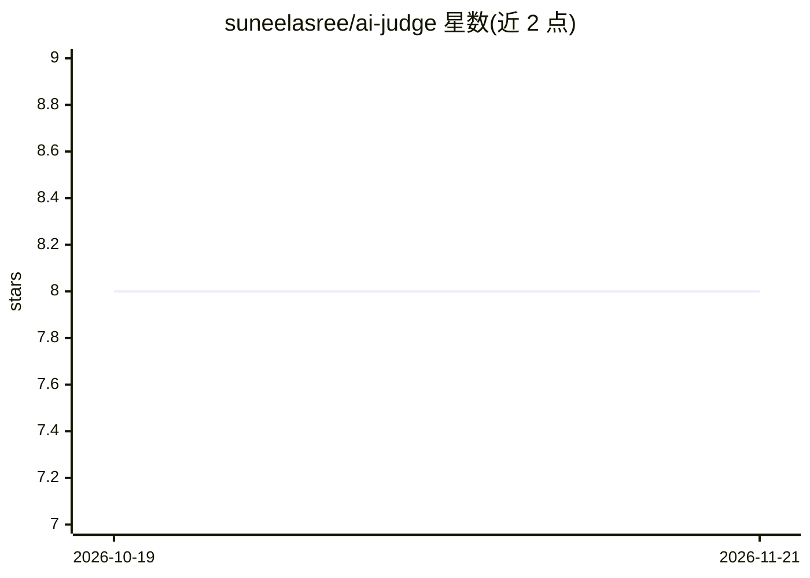

# suneelasree/ai-judge

⭐ 8 · TypeScript · MIT · 推送 2026-10-08 · [GitHub](https://github.com/suneelasree/ai-judge) · [官网](https://www.npmjs.com/package/@suneelasree/ai-judge) · 个人维护

**AI 测试工程师：读用户故事，自动执行 E2E 测试并回报缺陷**

面向 QA 与开发团队的自动化验收测试 CLI：读取 Jira issue 或 Markdown 故事文件，先经验收标准门（无 AC 或不可测即停止），再由 AI 设计含正/反/边界用例的测试计划，随后由工具化 agent 驱动真实 Chrome 逐步执行并截图取证，输出 passed/failed/blocked 判定与去重缺陷清单；写回 Jira 前必须经人工审批门。提供退出码以便接入 CI，支持以 StorySource 接口扩展其他追踪器。

## 筛选速览

| 维度 | 判定 | 备注 |
|---|---|---|
| AI 角色 | `ai-native` | 本体是模型或模型工具 |
| 许可风险 | `permissive` | MIT |
| 部署形态 | `library` | 以包/库形式分发 |
| 模型依赖 | locked-api |  |
| 硬件要求 | — | 无带数字的原话,不猜 |
| 安装摩擦 | `low` | 无编译、无系统依赖或容器化 |
| 成熟度 | — | 结构信号不足 |

## 能力要点

- 7 阶段流水线：读故事→AC 门→设计→执行→判定→缺陷→人工门
- AI agent 通过 15 个浏览器工具驱动真实 Chrome，逐步截图取证
- 安全机制：主机白名单、破坏性操作守卫、密钥隐藏、注入加固
- 环境问题标为 blocked 而非 failed，缺陷上报需人工批准

## 适用场景

- 为带验收标准的用户故事自动生成并执行 E2E 测试
- 把验收标准检查作为 CI 门禁步骤
- 测试失败后一键生成带截图证据的 Jira 缺陷单

## 场景标签

`浏览器自动化` · 领域:效率与自动化

## 证据(README 行号)

> L5: **Give it a user story. It reviews the acceptance criteria, designs test cases, tests your web app in Chrome like a 
> L23: |4. Execute|An AI agent drives a real Chrome window: reads the page, clicks, types, checks each expected result, an
> L99: - **AI:** Claude via the official Anthropic SDK. Stages 2, 3 and 6 use structured outputs validated by Zod schemas.

## 星数曲线

2026-10-19 8 → 2026-11-21 8（+0）

---
*卡片 v1 · prompt 1.4 · 生成 2026-11-20 · 置信度 high · 依据 README sha `d0291ded2d84` · [字段定义](../../DATASET.md)*
