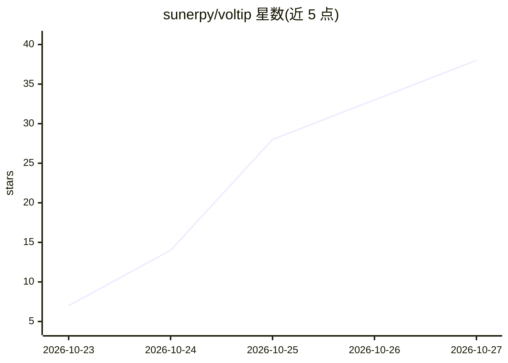

# sunerpy/voltip

⭐ 38 · Rust · AGPL-3.0 · 推送 2026-10-26 · [GitHub](https://github.com/sunerpy/voltip) · [官网](https://voltip.firlab.app/) · 个人维护 · 中文 README

**跨平台按住说话的听写应用：云端或本机语音转文字**

面向 Windows/macOS/Linux/Android 的听写工具：按住全局热键录音，语音识别可在云端（OpenAI、Groq、SiliconFlow、阿里云或任意 OpenAI 兼容端点）或本机（Qwen3-ASR、SenseVoice、Paraformer，支持 GPU/CPU）进行，可选 LLM 清理文本后粘贴到光标处。附带语音改写、场景化风格、最长两小时的分段转写与 SRT 导出、个人词典与替换规则。Android 端可独立使用，也可经 Noise XX 握手端到端加密配对，作为电脑的麦克风和键盘。桌面端提供安装包（.exe/.deb/.AppImage/.dmg），也可从源码构建；本机识别后音频不离开设备。

## 筛选速览

| 维度 | 判定 | 备注 |
|---|---|---|
| AI 角色 | `ai-native` | 本体是模型或模型工具 |
| 许可风险 | `viral` | AGPL-3.0 |
| 部署形态 | `desktop` | 安装包/桌面程序 |
| 模型依赖 | local-ok | 支持本地模型 |
| 硬件要求 | — | 无带数字的原话,不猜 |
| 安装摩擦 | `low` | 无编译、无系统依赖或容器化 |
| 成熟度 | — | 结构信号不足 |

## 能力要点

- 云端或本机语音识别（Qwen3-ASR/SenseVoice/Paraformer，GPU Vulkan/Metal 或 CPU）
- LLM 清理与语音改写、场景化输出风格、词典与正则替换规则
- 最长两小时录音分段转写，可导出 SRT 字幕
- Android 配对经 Noise XX 端到端加密，充当电脑的麦克风与键盘
- 可暴露 OpenAI 兼容 /v1/audio/transcriptions 本地服务供其他程序调用

## 适用场景

- 按住快捷键在任何应用里听写，文字落在光标处
- 离线本机识别，音频不出设备
- 长会议/讲座录音转写并导出字幕
- 用手机做电脑的无线麦克风和键盘

## 场景标签

`语音识别` · 领域:感知与多模态

## 证据(README 行号)

> L16: Voltip is a dictation app for Windows, Linux, macOS and Android. On the computer it records while
> L18: the text up with an LLM, and pastes it into whatever app has the focus. The Android app works on
> L36: - Recognition from a cloud provider (OpenAI, Groq, SiliconFlow, Alibaba Cloud Model Studio with its
> L38:  transcribe.cpp, SenseVoice and Paraformer through sherpa-onnx. Qwen3-ASR runs on the GPU when

## 星数曲线

2026-10-23 7 → 2026-10-27 38（+31）

---
*卡片 v1 · prompt 1.4 · 生成 2026-10-26 · 置信度 mid · 依据 README sha `d6c7bbfe5e2b` · [字段定义](../../DATASET.md)*
