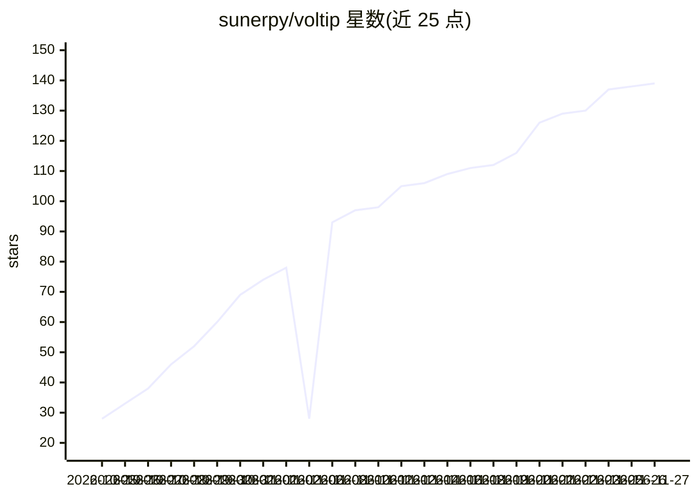

# sunerpy/voltip

⭐ 139 · Rust · AGPL-3.0 · 推送 2026-11-26 · [GitHub](https://github.com/sunerpy/voltip) · [官网](https://voltip.firlab.app/) · 个人维护 · 中文 README

**跨平台按住说话的语音输入应用，本机或云端识别**

Voltip 是一款面向 Windows、Linux、macOS 与 Android 的听写应用：按住全局快捷键说话，松开后把识别文本粘贴到当前焦点应用。识别可走云端提供商或本机模型（Qwen3-ASR、SenseVoice、Paraformer），可选 LLM 清洗文本，支持个人词典、替换规则、场景化润色、语音改写、最长两小时录音导出 SRT 字幕。Android 手机可独立使用，或经 Noise XX 端到端加密配对作为电脑的麦克风与键盘。提供安装包、headless 命令行与本地识别服务。

## 筛选速览

| 维度 | 判定 | 备注 |
|---|---|---|
| AI 角色 | `ai-native` | 本体是模型或模型工具 |
| 许可风险 | `viral` | AGPL-3.0 |
| 部署形态 | `desktop` | 安装包/桌面程序 |
| 模型依赖 | local-ok | 支持本地模型 |
| 硬件要求 | — | 无带数字的原话,不猜 |
| 安装摩擦 | `low` | 无编译、无系统依赖或容器化 |
| 成熟度 | — | 结构信号不足 |

## 能力要点

- 按住说话（push-to-talk）全局热键，悬浮条显示实时转写
- 本机识别模型 Qwen3-ASR 0.6B/1.7B（Vulkan/Metal GPU 加速）与 SenseVoice、Paraformer
- LLM 文本清洗与语音改写，支持多家云端及本地 Ollama
- Android 手机经 Noise XX 端到端加密配对作电脑麦克风与键盘，或独立听写

## 适用场景

- 在任意文本框里按住快捷键语音输入文字
- 会议或长录音转写并导出 SRT 字幕或要点摘要
- 离线环境下用本机模型识别，音频不出机器
- 用手机当作电脑的远程麦克风和键盘

## 场景标签

`语音识别` · 领域:感知与多模态

## 证据(README 行号)

> L16: Voltip is a dictation app for Windows, Linux, macOS and Android. On the computer it records while
> L36: - Recognition from a cloud provider (OpenAI, Groq, SiliconFlow, Alibaba Cloud Model Studio with its
> L37:  realtime models, or any OpenAI-compatible endpoint) or on-device: Qwen3-ASR 0.6B / 1.7B through

## 星数曲线

2026-10-25 28 → 2026-11-27 139（+111）

---
*卡片 v1 · prompt 1.4 · 生成 2026-11-27 · 置信度 mid · 依据 README sha `5f509b6f6fbd` · [字段定义](../../DATASET.md)*
