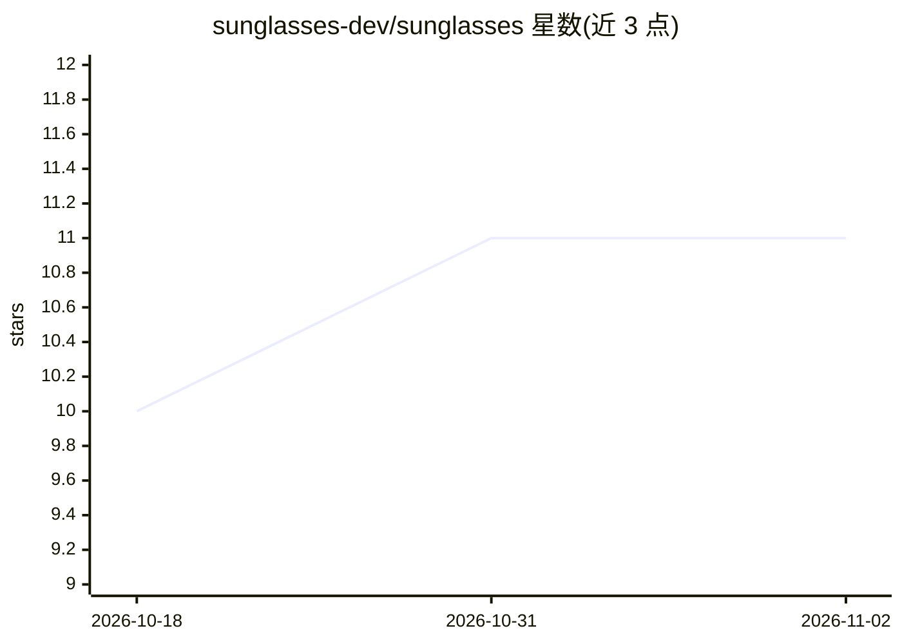

# sunglasses-dev/sunglasses

⭐ 11 · Python · MIT · 推送 2026-11-01 · [GitHub](https://github.com/sunglasses-dev/sunglasses) · [官网](https://sunglasses.dev) · 组织维护

**面向 AI agent 的本地输入防火墙与 MCP 代理（beta）**

本地运行的开源扫描器：用 1,512 条带匹配器的模式（共列出 1,583 条）、117 个类别，检查文本、代码、PDF、图像、二维码、音频与视频，报告命中的发现与未能读取的部分（INCOMPLETE），并以四种退出码区分 clean/threat/incomplete/错误。供开发者以 CLI、Python 库、MCP 服务器、GitHub Action 或 Claude Code hook 使用；另含一个 MCP 代理，在人工于交互终端批准服务器快照前拒绝所有 tools/list 与 tools/call，批准后仅在凭据通道上拦截工具调用与结果中的敏感信息。README 声明 beta，且明确代理非通用全量检查、安装本身不构成防护、部分规则（如 GLS-SD-010）受行首锚定限制。

## 筛选速览

| 维度 | 判定 | 备注 |
|---|---|---|
| AI 角色 | `ai-ecosystem` | LLM/agent 周边工具 |
| 许可风险 | `permissive` | MIT |
| 部署形态 | `desktop` | 安装包/桌面程序 |
| 模型依赖 | — | README 未给出锁定关系 |
| 硬件要求 | — | 无带数字的原话,不猜 |
| 安装摩擦 | `low` | 无编译、无系统依赖或容器化 |
| 成熟度 | `idea` | |

## 能力要点

- 1,512 条带匹配器模式、117 个类别，覆盖文本/文件/PDF/图像/二维码/音频/视频
- 区分 exit 0（读完且无命中）与 exit 3（未完整检查），is_clean 显式拆分两事实
- MCP 代理：批准前拒绝全部 tool 请求，批准后双向拦截凭据通道内容
- 提供 Claude Code hook 在工具运行前阻断凭据路径与策略违规

## 适用场景

- 在 CI 中扫描每个 PR 的敏感信息与提示注入内容
- 给 Claude Code 等 agent 加装工具调用前的凭据阻断钩子
- 为接入的 MCP 服务器做人工审批与凭据通道管控

## 场景标签

`网络安全` · 领域:学习与行业

## 证据(README 行号)

> L11: **Open source input firewall for AI agents, beta.** A local scanner checks text, code, PDFs, images, QR codes, audi
> L17: - A local MCP proxy that refuses every `tools/list` and `tools/call` until a person
> L26: produces findings and an exit status; a CI job, a Claude Code hook or your own code acts

## 星数曲线

2026-10-18 10 → 2026-11-02 11（+1）

---
*卡片 v1 · prompt 1.4 · 生成 2026-11-01 · 置信度 mid · 依据 README sha `cccf14aa3c74` · [字段定义](../../DATASET.md)*
