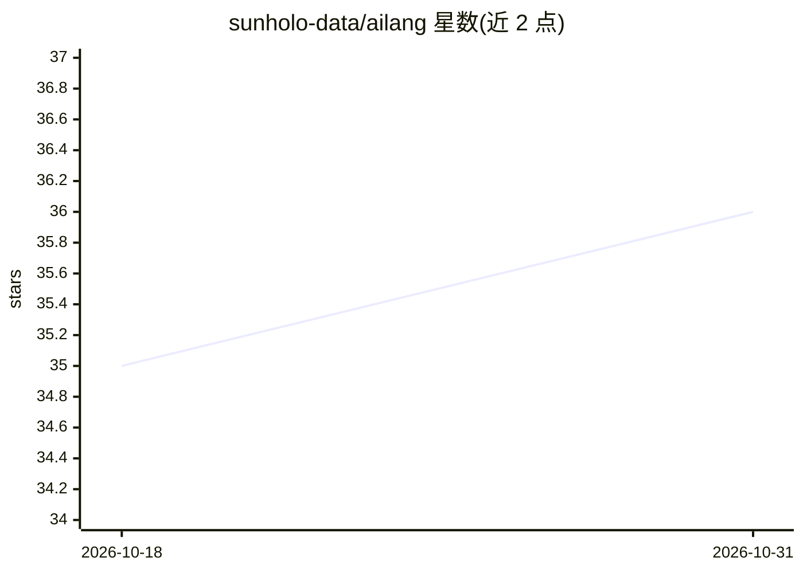

# sunholo-data/ailang

⭐ 36 · Go · Apache-2.0 · 推送 2026-10-30 · [GitHub](https://github.com/sunholo-data/ailang) · [官网](http://ailang.sunholo.com/) · 组织维护

**面向 AI 编码代理的确定性纯函数式编程语言及 CLI**

AILANG 是一门纯函数式、带效果类型系统的编程语言，定位为 AI 生成代码的确定性执行基底：每个构造具有可反射、可验证、可序列化的确定性语义。提供独立 CLI（含 run、repl、lsp 子命令）、内置 LSP 与 VS Code 一键安装；通过 AILANG Bootstrap 插件向 Claude Code 与 OpenAI Codex 提供本地 MCP 工具、技能与语法指引。安装为 curl 脚本或 GitHub Releases 二进制（macOS arm64 等），开发构建用 make。Apache 2.0 许可。

## 筛选速览

| 维度 | 判定 | 备注 |
|---|---|---|
| AI 角色 | `ai-ecosystem` | LLM/agent 周边工具 |
| 许可风险 | `permissive` | Apache-2.0 |
| 部署形态 | `None` |  |
| 模型依赖 | locked-api |  |
| 硬件要求 | — | 无带数字的原话,不猜 |
| 安装摩擦 | `medium` | 含编译或系统依赖之一 |
| 成熟度 | — | 结构信号不足 |

## 能力要点

- 纯函数式核心：λ 演算、闭包、模式匹配、ADT，Hindley-Milner 类型推断与行多态
- 基于 capability 的效果系统（IO/FS/Net/Clock/AI）与可重放执行
- CLI 二进制内置 LSP（诊断/hover/跳转定义），一键安装 VS Code 扩展
- 为 Claude Code 与 OpenAI Codex 提供插件：本地 MCP 工具（ailang_run/ailang_check 等）与技能

## 适用场景

- 让 Claude Code / Codex 等 AI 编码代理生成并运行可验证的确定性代码
- 以结构化 trace 与可重放执行调试 AI 生成程序
- 在 VS Code 中编辑 .ail 文件并获得 LSP 支持

## 场景标签

 · 领域:编程语言/开发者工具

## 证据(README 行号)

> L19: AILANG is a purely functional, effect-typed language designed as a **deterministic execution substrate** for AI-gen
> L25: AILANG is designed to be used by AI coding agents. The
> L137: - **AI-first** - Designed for machine reasoning, not human convenience

## 星数曲线

2026-10-18 35 → 2026-10-31 36（+1）

---
*卡片 v1 · prompt 1.4 · 生成 2026-10-25 · 置信度 high · 依据 README sha `1092f68c310c` · [字段定义](../../DATASET.md)*
