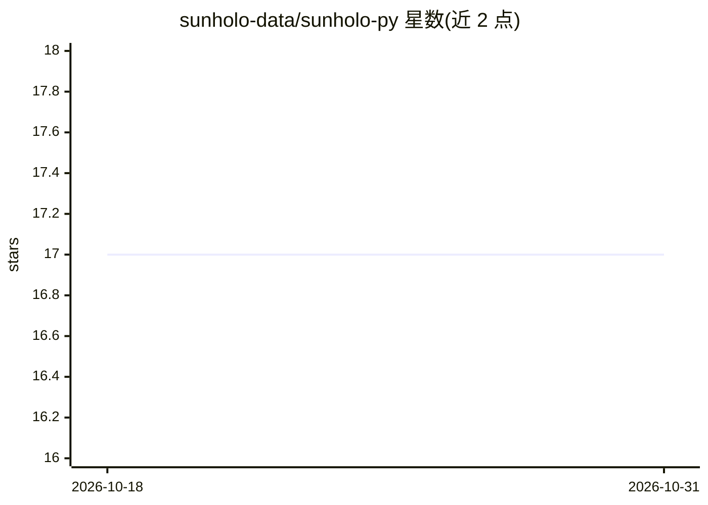

# sunholo-data/sunholo-py

⭐ 17 · Python · Apache-2.0 · 推送 2026-03-12 · [GitHub](https://github.com/sunholo-data/sunholo-py) · [官网](https://dev.sunholo.com/) · 组织维护

**在 Google Cloud 上构建 GenAI 应用的 Python DevOps 框架**

配置驱动（YAML）的 Python 框架，用于开发、部署与管理生成式 AI 应用（VAC，Virtual Agent Computers）。支持接入 Vertex AI、OpenAI、Anthropic、Ollama 等多种 LLM 提供方，集成 AlloyDB、Discovery Engine、LanceDB、Supabase 等向量存储与搜索，支持流式响应、文档分块与嵌入管道、Pub/Sub 异步处理，并可部署到 Cloud Run。提供 CLI 工具（sunholo init/vac chat/deploy）与 Flask/FastAPI 模板，深度绑定 Google Cloud 服务，也兼容 LangChain/LlamaIndex 与 MCP。通过 uv 从 PyPI 安装。

## 筛选速览

| 维度 | 判定 | 备注 |
|---|---|---|
| AI 角色 | `ai-ecosystem` | LLM/agent 周边工具 |
| 许可风险 | `permissive` | Apache-2.0 |
| 部署形态 | `library` | 以包/库形式分发 |
| 模型依赖 | local-ok | 支持本地模型 |
| 硬件要求 | — | 无带数字的原话,不猜 |
| 安装摩擦 | `low` | 无编译、无系统依赖或容器化 |
| 成熟度 | — | 结构信号不足 |

## 能力要点

- 配置驱动：YAML 定义 VAC，CLI 一键初始化、本地对话与部署
- 多 LLM 提供方接入：Vertex AI、OpenAI、Anthropic、Ollama
- Google Cloud 深度集成：Cloud Run、AlloyDB、Discovery Engine、Pub/Sub、Cloud Storage
- 支持 MCP server/client、OpenAI 兼容端点、Langfuse 可观测性

## 适用场景

- 在 Google Cloud 上搭建并部署对话式 AI agent
- 用统一配置管理多个 LLM 提供方与向量存储
- 构建带文档分块、嵌入与 RAG 检索的应用
- 以 Flask/FastAPI 模板生成 API 或聊天应用

## 场景标签

`Agent 框架` `RAG` · 领域:Agent 开发

## 证据(README 行号)

> L7: 🚀 **AI DevOps framework for building GenAI applications on Google Cloud Platform**
> L9: Sunholo is a comprehensive Python framework that streamlines the development, deployment, and management of Generati
> L14: - 🤖 Build conversational AI agents with any LLM provider (Vertex AI, OpenAI, Anthropic, Ollama)

## 星数曲线

2026-10-18 17 → 2026-10-31 17（+0）

---
*卡片 v1 · prompt 1.4 · 生成 2026-10-29 · 置信度 high · 依据 README sha `b6ff4ccd30ed` · [字段定义](../../DATASET.md)*
