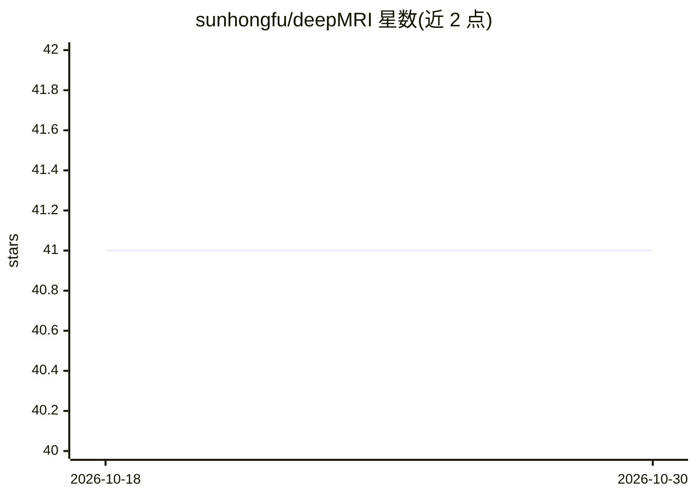

# sunhongfu/deepMRI

⭐ 41 · GPL-3.0 · 推送 2026-04-30 · [GitHub](https://github.com/sunhongfu/deepMRI) · 组织维护

**面向MRI重建与定量成像的深度学习方法集合**

由科研团队维护的MRI深度学习工具聚合仓库：收录10个方法（AFTER-QSM、BFRnet、DCRNet、iQSM、QSMDiff等），覆盖QSM重建、背景场去除、相位解缠、R2*定量成像等任务，均发表于NeuroImage、Med Image Anal等期刊。每个方法位于独立子仓库，本仓库提供链接与简要README；iQSM+另提供浏览器端Web应用，供临床人员免MATLAB/命令行使用。

## 筛选速览

| 维度 | 判定 | 备注 |
|---|---|---|
| AI 角色 | `ai-native` | 本体是模型或模型工具 |
| 许可风险 | `viral` | GPL-3.0 |
| 部署形态 | `None` |  |
| 模型依赖 | — | README 未给出锁定关系 |
| 硬件要求 | — | 无带数字的原话,不猜 |
| 安装摩擦 | `low` | 无编译、无系统依赖或容器化 |
| 成熟度 | — | 结构信号不足 |

## 能力要点

- 收录10个MRI重建与定量成像深度学习方法
- 各方法对应独立仓库，附论文、模型权重与演示数据
- iQSM+提供面向临床人员的浏览器端Web应用

## 适用场景

- 研究者查找QSM重建相关深度学习方法及论文
- 临床人员通过浏览器使用iQSM+进行QSM处理
- 获取各方法的模型权重与演示数据复现实验

## 场景标签

`科研工具` · 领域:学习与行业

## 证据(README 行号)

> L5: This repository is a collection of deep learning tools for MRI reconstruction and quantitative mapping. Each method 
> L11: |Method|Task|Paper|

## 星数曲线

2026-10-18 41 → 2026-10-30 41（+0）

---
*卡片 v1 · prompt 1.4 · 生成 2026-10-25 · 置信度 high · 依据 README sha `0d43386d8189` · [字段定义](../../DATASET.md)*
