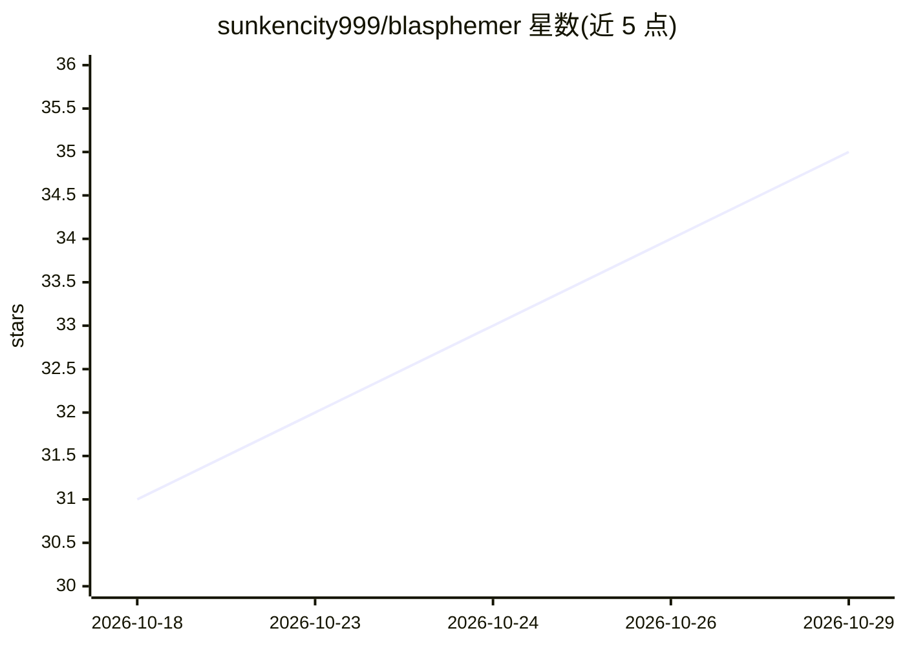

# sunkencity999/blasphemer

⭐ 35 · Python · AGPL-3.0 · 推送 2026-07-22 · [GitHub](https://github.com/sunkencity999/blasphemer) · 个人维护

**macOS 优化版 LLM 去审查工具：abliteration+LoRA+断点续跑**

Heretic 的增强分支，面向 macOS（Apple Silicon）用户：通过方向消融（abliteration）与 TPE 参数优化自动移除 transformer 语言模型的拒绝对齐，无需后训练；增加 SQLite 检查点/断点续跑、LoRA 微调注入自定义知识（PDF/文本/HuggingFace 数据集）、DPO 能力修复、一键 GGUF 转换并集成 LM Studio。原生支持 MPS GPU 检测与 torch.compile 优化，README 称消融耗时减少 55%。限制：不支持多模态模型、70B 以上模型、SSM/Mamba 架构及推理链模型（效果减弱）。

## 筛选速览

| 维度 | 判定 | 备注 |
|---|---|---|
| AI 角色 | `ai-ecosystem` | LLM/agent 周边工具 |
| 许可风险 | `viral` | AGPL-3.0 |
| 部署形态 | `None` |  |
| 模型依赖 | local-ok | 支持本地模型 |
| 硬件要求 | — | 无带数字的原话,不猜 |
| 安装摩擦 | `medium` | 含编译或系统依赖之一 |
| 成熟度 | — | 结构信号不足 |

## 能力要点

- 方向消融自动去审查，配合 TPE 参数优化，无需理解模型内部
- SQLite 检查点系统，中断后自动续跑
- LoRA 微调注入自定义知识后可直接导出 GGUF
- MPS 原生 GPU 检测与 torch.compile 优化

## 适用场景

- 在 Mac 上本地去除 LLM 的安全对齐拒绝行为
- 去审查后用自有文档微调模型再转 GGUF 供 LM Studio 使用
- 长时间消融任务中断后从断点恢复

## 场景标签

`微调` · 领域:训练与推理

## 证据(README 行号)

> L3: **Enhanced fork of Heretic optimized for macOS (Apple Silicon) - 55% faster with LoRA fine-tuning and advanced optim
> L7: Blasphemer removes censorship from transformer-based language models without expensive post-training, featuring auto
> L106: Heretic (the original project) combines advanced directional ablation with TPE-based parameter optimization to aut

## 星数曲线

2026-10-18 31 → 2026-10-29 35（+4）

---
*卡片 v1 · prompt 1.4 · 生成 2026-10-25 · 置信度 high · 依据 README sha `188c4388610c` · [字段定义](../../DATASET.md)*
