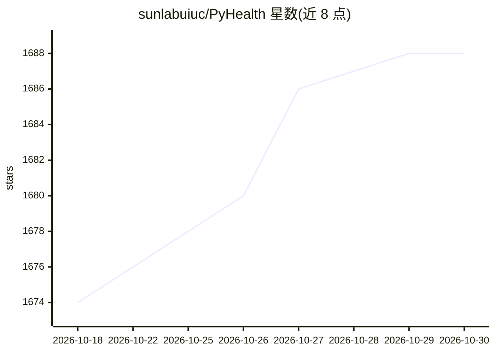

# sunlabuiuc/PyHealth

⭐ 1,688 · Python · MIT · 推送 2026-10-29 · [GitHub](https://github.com/sunlabuiuc/PyHealth) · [官网](https://pyhealth.dev) · 组织维护

**面向临床预测建模的医疗深度学习 Python 工具包**

面向 ML 研究者与医疗从业者的临床深度学习工具包，提供模块化五阶段流水线：数据集（MIMIC-III/IV、eICU、OMOP-CDM 等）、任务定义（药物推荐、死亡率/再入院预测、睡眠分期等）、33+ 预置模型（RNN/Transformer/SafeDrug 等）、训练器与评估指标，官方称 10 行代码即可搭建一条医疗 AI 流水线。另含可独立使用的医学编码本体查询与跨编码系统映射模块（ICD9CM↔CCSCM、NDC→RxNorm/ATC）。PyHealth 2.0 要求 Python ≥3.12,<3.14，旧版 1.16 支持 3.9+。

## 筛选速览

| 维度 | 判定 | 备注 |
|---|---|---|
| AI 角色 | `ai-native` | 本体是模型或模型工具 |
| 许可风险 | `permissive` | MIT |
| 部署形态 | `library` | 以包/库形式分发 |
| 模型依赖 | — | README 未给出锁定关系 |
| 硬件要求 | — | 无带数字的原话,不猜 |
| 安装摩擦 | `low` | 无编译、无系统依赖或容器化 |
| 成熟度 | — | 结构信号不足 |

## 能力要点

- 模块化五阶段流水线：datasets/tasks/models/trainer/metrics
- 支持 MIMIC-III/IV、eICU、OMOP-CDM 等临床数据集与 10+ 医疗任务
- 33+ 预置模型（RNN、Transformer、RETAIN、SafeDrug 等）
- 医学编码本体查询与跨系统映射模块（ICD9CM、NDC、RxNorm、ATC）可独立使用

## 适用场景

- 在 MIMIC 等临床数据上训练死亡率/再入院预测等模型
- 快速复现论文中的医疗预测模型与基准
- 做医学编码（ICD/ATC/NDC）的查询与跨系统映射

## 场景标签

`模型训练` `科研工具` · 领域:学习与行业

## 证据(README 行号)

> L82: PyHealth is a comprehensive deep learning toolkit for supporting clinical predictive modeling, which is designed fo
> L88: - 33+ pre-built models and production-ready trainer/metrics

## 星数曲线

2026-10-18 1,674 → 2026-10-30 1,688（+14）

---
*卡片 v1 · prompt 1.4 · 生成 2026-10-21 · 置信度 high · 依据 README sha `95ccab62b474` · [字段定义](../../DATASET.md)*
