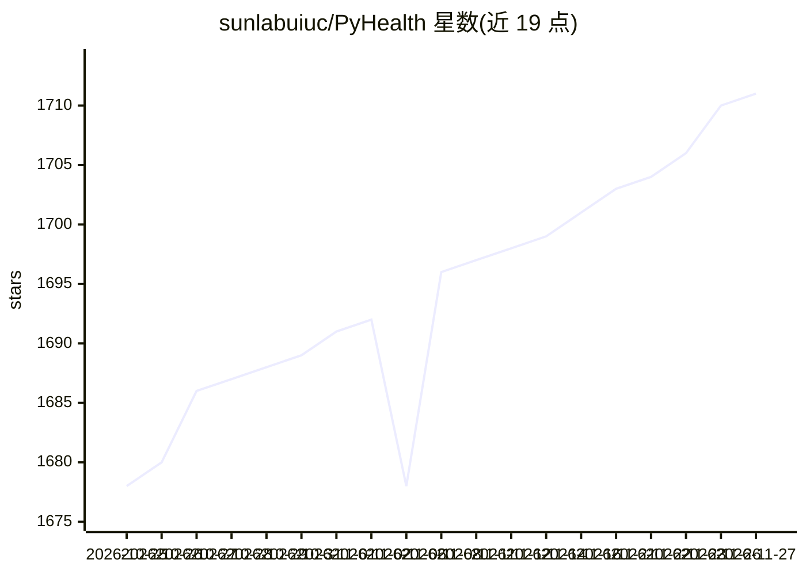

# sunlabuiuc/PyHealth

⭐ 1,711 · Python · MIT · 推送 2026-11-26 · [GitHub](https://github.com/sunlabuiuc/PyHealth) · [官网](https://pyhealth.dev) · 组织维护

**面向医疗研究的临床深度学习训练工具包**

基于 PyTorch 的医疗 AI 工具包，按五阶段流水线组织：数据集读取（MIMIC-III/IV、eICU、OMOP-CDM、睡眠 EEG、胸片等）、任务样本构建（死亡率、再入院、药物推荐、睡眠分期等）、模型训练（33+ 模型，统一接口，可一行切换）、训练器（自动保存最优检查点）与评估指标（校准、bootstrap 置信区间）。附带独立的医学编码查询与映射模块（ICD/CCS/ATC/NDC/RxNorm）和代码 tokenizer。主要面向临床研究人员与开发者。要求 Python 3.12–3.13。

## 筛选速览

| 维度 | 判定 | 备注 |
|---|---|---|
| AI 角色 | `ai-native` | 本体是模型或模型工具 |
| 许可风险 | `permissive` | MIT |
| 部署形态 | `library` | 以包/库形式分发 |
| 模型依赖 | — | README 未给出锁定关系 |
| 硬件要求 | — | 无带数字的原话,不猜 |
| 安装摩擦 | `low` | 无编译、无系统依赖或容器化 |
| 成熟度 | — | 结构信号不足 |

## 能力要点

- 支持 MIMIC-III/IV、eICU、OMOP-CDM、EHRShot、睡眠与 EEG 数据集的读取
- 33+ 模型统一接口（RETAIN、SafeDrug、GAMENet、StageNet 等），换模型改一行
- 患者级数据划分、校准指标与 bootstrap 置信区间的可复现评估
- 医学编码查询与跨系统映射模块可独立使用

## 适用场景

- 在 MIMIC 数据上训练院内死亡率或再入院预测模型
- 复现已发表的临床预测基准实验
- 在 ICD、ATC、RxNorm 等编码系统间做术语映射
- 对临床文本、生理信号与医学影像建模

## 场景标签

`模型训练` · 领域:训练与推理

## 证据(README 行号)

> L5: PyHealth is an open-source PyTorch toolkit for building, benchmarking and reproducing clinical AI models. It works w
> L51: - **Ready-made clinical tasks.** Mortality, readmission, length of stay, drug recommendation, medical coding, sleep
> L128: - **ML models**: ``RNN``, ``LSTM``, ``GRU``, ``Transformer``, ``RETAIN``, ``SafeDrug``, ``GAMENet``, ``MoleRec``, 

## 星数曲线

2026-10-25 1,678 → 2026-11-27 1,711（+33）

---
*卡片 v1 · prompt 1.4 · 生成 2026-11-23 · 置信度 high · 依据 README sha `73ab486afaed` · [字段定义](../../DATASET.md)*
