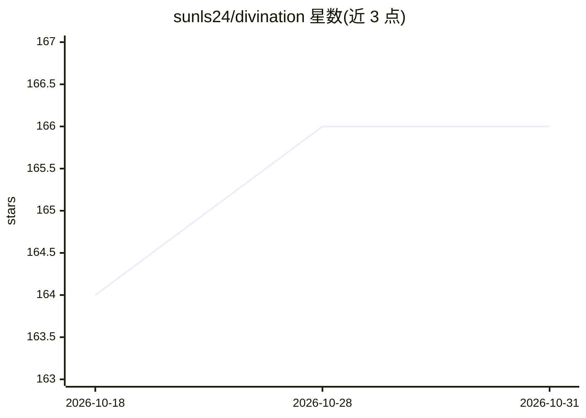

# sunls24/divination

⭐ 166 · TypeScript · MIT · 推送 2026-01-02 · [GitHub](https://github.com/sunls24/divination) · [官网](https://divination.sunls.de) · 个人维护 · 中文 README

**AI 解读易经卦象的网页算卦应用**

基于 Next.js 的算卦网页应用：用户进行六次硬币随机卜筮，程序生成对应卦象，再调用 OpenAI 接口的模型对卦象生成文字解读。通过环境变量配置 API key、接口地址与模型名（默认 gpt-3.5-turbo），支持自定义 OpenAI 兼容端点。提供克隆仓库、pnpm 安装依赖后本地运行的方式，也可一键部署到 Vercel。另有暂不开源的 V2 版本宣称添加生辰八字与周公解梦模块。

## 筛选速览

| 维度 | 判定 | 备注 |
|---|---|---|
| AI 角色 | `ai-native` | 本体是模型或模型工具 |
| 许可风险 | `permissive` | MIT |
| 部署形态 | `library` | 以包/库形式分发 |
| 模型依赖 | — | README 未给出锁定关系 |
| 硬件要求 | — | 无带数字的原话,不猜 |
| 安装摩擦 | `low` | 无编译、无系统依赖或容器化 |
| 成熟度 | — | 结构信号不足 |

## 能力要点

- 六次硬币随机卜筮生成卦象
- AI 对卦象生成解读文字
- 支持自定义 OpenAI 兼容接口地址与模型
- 提供 Vercel 一键部署入口

## 适用场景

- 我想在线算一卦并获得 AI 的解读
- 想自己部署一个算卦小站供朋友使用
- 接入自定义的 OpenAI 兼容模型服务

## 场景标签

 · 领域:娱乐/传统文化应用

## 证据(README 行号)

> L3: **AI 算卦：** 通过进行六次硬币的随机卜筮，生成卦象，并使用 AI 对卦象进行解读。
> L15: - `OPENAI_MODEL`：自定义 OpenAI 模型，默认：`gpt-3.5-turbo`

## 星数曲线

2026-10-18 164 → 2026-10-31 166（+2）

---
*卡片 v1 · prompt 1.4 · 生成 2026-10-22 · 置信度 high · 依据 README sha `a3fbcdc87deb` · [字段定义](../../DATASET.md)*
