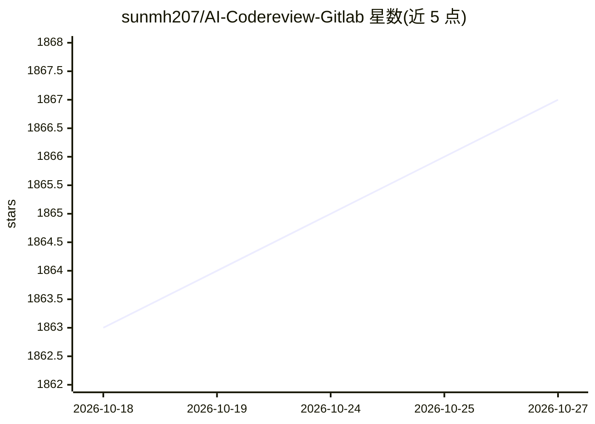

# sunmh207/AI-Codereview-Gitlab

⭐ 1,867 · Python · Apache-2.0 · 推送 2026-10-08 · [GitHub](https://github.com/sunmh207/AI-Codereview-Gitlab) · 个人维护 · 中文 README

**基于大模型的 GitLab 自动代码审查与日报工具，带可视化 Dashboard**

面向开发团队的自动化代码审查服务：通过 GitLab Webhook 在 Push/Merge Request 时触发，调用第三方大模型生成审查结果并回写到 MR/Commit Note，支持钉钉/企业微信/飞书推送与基于 Commit 记录的自动化日报，附 Streamlit 可视化 Dashboard。兼容 DeepSeek、ZhipuAI、OpenAI、Anthropic、通义千问与 Ollama 等多种模型。提供 Docker 与本地 Python 两种部署方式；可选 Agentic 模式让 LLM 在沙箱内自主探索代码库，失败时自动降级回 diff_only。另有功能更丰富的 Pro 版本。

## 筛选速览

| 维度 | 判定 | 备注 |
|---|---|---|
| AI 角色 | `ai-native` | 本体是模型或模型工具 |
| 许可风险 | `permissive` | Apache-2.0 |
| 部署形态 | `self-host` | docker 或自建部署 |
| 模型依赖 | local-ok | 支持本地模型 |
| 硬件要求 | — | 无带数字的原话,不猜 |
| 安装摩擦 | `low` | 无编译、无系统依赖或容器化 |
| 成熟度 | — | 结构信号不足 |

## 能力要点

- 多模型支持：DeepSeek、ZhipuAI、OpenAI、Anthropic、通义千问、Ollama
- 审查结果推送钉钉/企业微信/飞书，并自动生成开发日报
- 可视化 Dashboard 集中展示审查记录与项目/开发者统计
- 可选 Agentic Review：沙箱 shell + 工具调用自主探索代码库，失败自动降级

## 适用场景

- 团队在 GitLab 合并/提交时自动做 AI 代码审查
- 把代码审查结果即时推送到钉钉/企业微信/飞书群
- 基于 Commit 记录自动生成每日开发进展日报

## 场景标签

`代码审查` · 领域:编码与开发

## 证据(README 行号)

> L8: 本项目是一个基于大模型的自动化代码审查工具，帮助开发团队在代码合并或提交时，快速进行智能化的审查(Code Review)，提升代码质量和开发效率。
> L44: 当用户在 GitLab 上提交代码（如 Merge Request 或 Push 操作）时，GitLab 将自动触发 webhook
> L45: 事件，调用本系统的接口。系统随后通过第三方大模型对代码进行审查，并将审查结果直接反馈到对应的 Merge Request 或 Commit 的

## 星数曲线

2026-10-18 1,863 → 2026-10-27 1,867（+4）

---
*卡片 v1 · prompt 1.4 · 生成 2026-10-21 · 置信度 mid · 依据 README sha `ebb35fe11411` · [字段定义](../../DATASET.md)*
