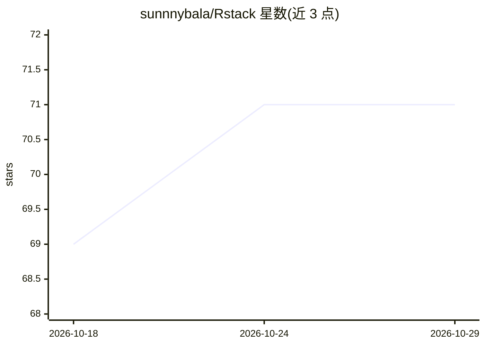

# sunnnybala/Rstack

⭐ 71 · Shell · MIT · 推送 2026-10-26 · [GitHub](https://github.com/sunnnybala/Rstack) · 个人维护

**面向科研者的 Claude Code 研究自动化技能集：想法到可投稿论文**

以 SKILL.md 文件形式提供给 Claude Code 的研究自动化技能集：/lit-review 查找文献与缺口分析、/novelty-check 新颖性评估、/experiment 生成代码并经 Modal 云 GPU 运行实验、/analyze-results 产出图表统计、/write-paper 生成会议格式的 LaTeX 论文，/research 串起全流程。每个阶段边界设有人工检查点。无后端与数据库，Claude Code 即运行时；产出以普通文件存于项目根目录，结构化日志写入 .rstack/。需 Claude Code、Python 3.8+，云端实验另需 Modal 与 tectonic。

## 筛选速览

| 维度 | 判定 | 备注 |
|---|---|---|
| AI 角色 | `ai-ecosystem` | LLM/agent 周边工具 |
| 许可风险 | `permissive` | MIT |
| 部署形态 | `library` | 以包/库形式分发 |
| 模型依赖 | locked-api |  |
| 硬件要求 | — | 无带数字的原话,不猜 |
| 安装摩擦 | `low` | 无编译、无系统依赖或容器化 |
| 成熟度 | — | 结构信号不足 |

## 能力要点

- idea→文献→新颖性→实验→分析→论文的全流程技能链，可单独使用
- 每阶段边界均设人工审批检查点，迭代而非线性
- 通过 Modal CLI 直接运行云 GPU 实验，无自定义包装
- 纯 SKILL.md 文件实现，Claude Code 即运行时

## 适用场景

- 一句话让 Claude Code 完成从研究想法到 LaTeX 论文草稿的流程
- 自动查找文献并做结构化综述与缺口分析
- 生成实验代码并在 Modal 云 GPU 上训练与迭代

## 场景标签

`科研工具` · 领域:学习与行业

## 证据(README 行号)

> L7: Research automation skills for Claude Code. Type `/research` and go from idea to submittable paper. Each skill works
> L75: - **Pure SKILL.md files** — no Express, no React, no Postgres. Claude Code IS the runtime.

## 星数曲线

2026-10-18 69 → 2026-10-29 71（+2）

---
*卡片 v1 · prompt 1.4 · 生成 2026-10-24 · 置信度 mid · 依据 README sha `1f381ec07a36` · [字段定义](../../DATASET.md)*
