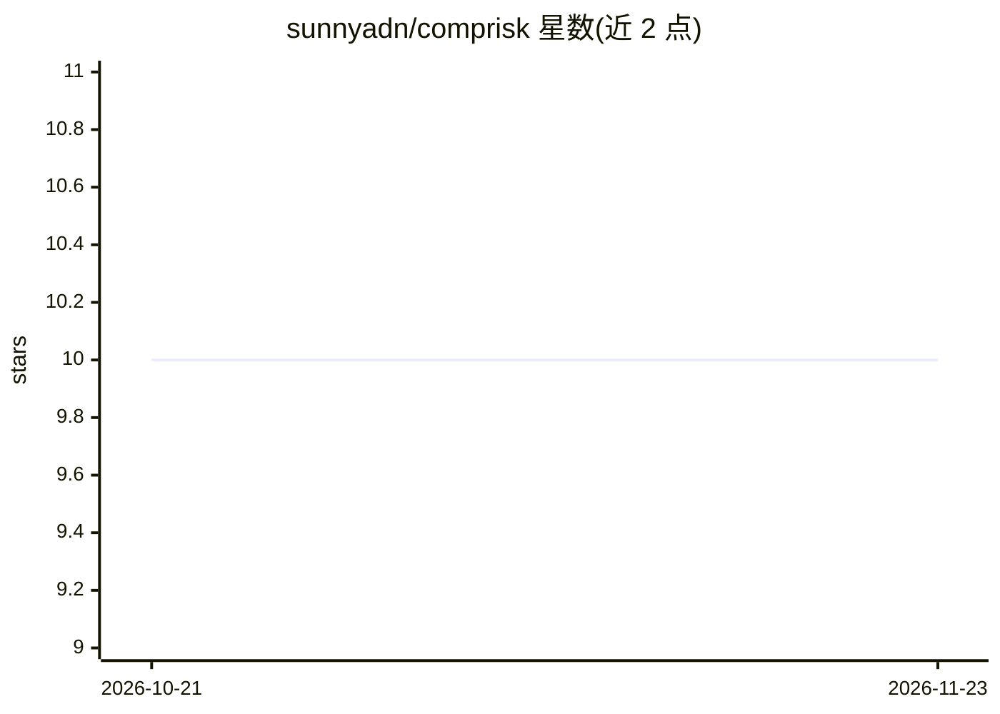

# sunnyadn/comprisk

⭐ 10 · Python · Apache-2.0 · 推送 2026-09-29 · [GitHub](https://github.com/sunnyadn/comprisk) · [官网](https://sunnyadn.github.io/comprisk/) · 个人维护

**面向应用研究者的纯 Python 竞争风险生存分析工具包**

提供 scikit-learn 兼容的竞争风险随机生存森林，以及 Fine-Gray 回归、病因别 Cox、Aalen-Johansen CIF、Gray 检验等经典方法，输出经与 R 的 cmprsk/survival 对比的浮点容差校验；支持 IPCW 时间依赖 AUC/Brier 评分、校准、OOB VIMP、最小深度与 exact TreeSHAP。含 equivalence="rfsrc" 复现模式与 GPU 预览（CUDA 12）。当前为 alpha 状态，API 在 v1.0 前可能变动；不支持稀疏 X，也无法通过 sklearn 完整 check_estimator（y 需时间+事件二元组）。

## 筛选速览

| 维度 | 判定 | 备注 |
|---|---|---|
| AI 角色 | `ai-native` | 本体是模型或模型工具 |
| 许可风险 | `permissive` | Apache-2.0 |
| 部署形态 | `library` | 以包/库形式分发 |
| 模型依赖 | — | README 未给出锁定关系 |
| 硬件要求 | — | 无带数字的原话,不猜 |
| 安装摩擦 | `medium` | 含编译或系统依赖之一 |
| 成熟度 | `idea` | |

## 能力要点

- 竞争风险随机生存森林：CR log-rank 分裂、AJ CIF、Nelson-Aalen CHF、OOB VIMP、最小深度、exact TreeSHAP
- Fine-Gray（含惩罚版）、病因别 Cox、Aalen-Johansen CIF、Gray 检验，与 R 实现做浮点容差校验
- IPCW 时间依赖 AUC/Brier 评分与校准工具，含闭式 C-index 置信区间
- equivalence="rfsrc" 逐位复现 rfSRC 的每树 RNG 流；GPU 预览（CUDA 12）

## 适用场景

- 在 Python 中直接完成竞争风险建模，省去 Python→R 往返
- 对 EHR/SEER 类大规模队列数据拟合竞争风险森林并输出 CIF
- 用 TreeSHAP/VIMP/最小深度解释生存模型特征贡献
- 在 sklearn Pipeline/GridSearchCV 中交叉验证生存估计器

## 场景标签

`科研工具` · 领域:学习与行业

## 证据(README 行号)

> L9: A Python toolkit for **competing-risks** survival analysis: a scalable,
> L10: scikit-learn-compatible competing-risks random survival forest plus the canonical
> L54: **quickstart**. Every estimator here is a real sklearn

## 星数曲线

2026-10-21 10 → 2026-11-23 10（+0）

---
*卡片 v1 · prompt 1.4 · 生成 2026-11-19 · 置信度 high · 依据 README sha `b05a57197f8e` · [字段定义](../../DATASET.md)*
