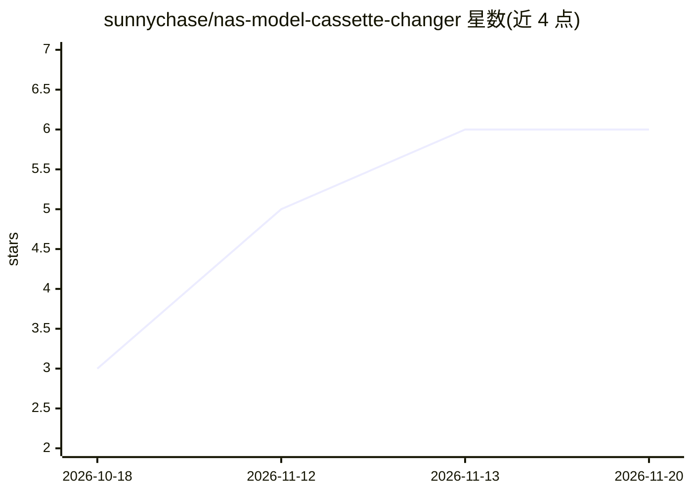

# sunnychase/nas-model-cassette-changer

⭐ — · [GitHub]() · 个人维护

**自托管者把模型库放在 NAS、一键装入 GPU 机的换卡工具**

面向 NAS + GPU 双机环境的本地模型管理工具：NAS 端索引器编目模型文件夹（厂商、变体、格式、量化、大小并估算节点数），GPU 机端 Web 页面一键 INSERT 将模型复制到本地 NVMe 并以 Ollama（GGUF）或 vLLM/SGLang 容器（safetensors）启动；插入前的 guard 会列出将被停止的模型并等待逐名确认，受保护模型保留显存。含基准测试、48 小时/30 天历史与 ntfy 手机告警。仅用 Python 标准库（3.9+），依赖 ssh/rsync/systemd，另有无需 NAS/GPU 的演示模式。

## 筛选速览

| 维度 | 判定 | 备注 |
|---|---|---|
| AI 角色 | `ai-ecosystem` | LLM/agent 周边工具 |
| 许可风险 | `permissive` | — |
| 部署形态 | `library` | 以包/库形式分发 |
| 模型依赖 | local-ok | 支持本地模型 |
| 硬件要求 | — | 无带数字的原话,不猜 |
| 安装摩擦 | `low` | 无编译、无系统依赖或容器化 |
| 成熟度 | — | 结构信号不足 |

## 能力要点

- 一键 INSERT：复制模型到本地 NVMe 并启动 Ollama/vLLM/SGLang
- guard 机制：插入前列出将被驱逐的模型并等待逐名确认，protected 模型保留显存
- bench：长上下文 1/2/4/8 流解码、1k–256k prefill 扫描与 60 题质量测试
- 纯 Python 标准库实现，提供无硬件的 demo 模式

## 适用场景

- GPU 机磁盘小、模型库存 NAS 的 homelab 用户管理本地大模型
- 切换模型时避免误停正在使用的服务
- 对本地推理引擎做长上下文与多并发基准测量

## 场景标签

`模型评测` · 领域:评测与运维

## 证据(README 行号)

> L41: - **The deck (GPU box)**: a web page lists the whole shelf. Press **INSERT** and it copies the model to local NVMe 
> L14:  Engines: Ollama, vLLM, SGLang

## 星数曲线

2026-10-18 3 → 2026-11-20 6（+3）

---
*卡片 v1 · prompt 1.4 · 生成 2026-11-20 · 置信度 mid · 依据 README sha `8701d0aac052` · [字段定义](../../DATASET.md)*
