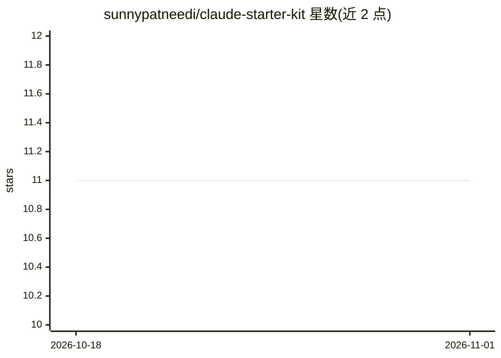

# sunnypatneedi/claude-starter-kit

⭐ 11 · Shell · NOASSERTION · 推送 2026-03-04 · [GitHub](https://github.com/sunnypatneedi/claude-starter-kit) · 个人维护

**面向 Claude Code/Cowork 的 70+ agents、skills、hooks 与 MCP 配置套件**

为 Claude Code 与 Claude Cowork 提供即装的助手套件：29 个 agents、41 个 skills、hooks 与 MCP 外部工具配置模板，覆盖个人效率、商业与工程三类场景。通过插件市场命令、模板仓库或 curl 安装脚本写入 .claude/ 目录，Claude 依据提问自动选择对应助手。skills 带反馈闭环：会话结束后收集反馈存至本地，由 /skill-improver 定期更新技能内容。用户可编辑 CLAUDE.md 定制项目指令，也可自行添加 agents 或配置 MCP 连接 GitHub、Slack 等。许可为 CC BY-SA 4.0。

## 筛选速览

| 维度 | 判定 | 备注 |
|---|---|---|
| AI 角色 | `ai-ecosystem` | LLM/agent 周边工具 |
| 许可风险 | `none` | NOASSERTION |
| 部署形态 | `None` |  |
| 模型依赖 | — | README 未给出锁定关系 |
| 硬件要求 | — | 无带数字的原话,不猜 |
| 安装摩擦 | `low` | 无编译、无系统依赖或容器化 |
| 成熟度 | — | 结构信号不足 |

## 能力要点

- 29 个 agents + 41 个 skills，覆盖个人/商业/工程三类
- 三种安装途径：插件市场、仓库模板、curl 安装脚本
- skills 自改进机制：本地反馈收集 + /skill-improver 定期更新
- MCP 配置模板可连接 GitHub、Slack、数据库等外部工具

## 适用场景

- 为 Claude Code 快速配置一批现成的代码评审、调试、架构类助手
- 让 Claude 辅助做周计划、写作教练、面试准备等个人事务
- 按项目定制 CLAUDE.md 与自定义 agent
- 配置 MCP 连接外部工具扩展 Claude 能力

## 场景标签

`提示工程` · 领域:Agent 开发

## 证据(README 行号)

> L11: Get 70+ ready-to-use helpers for productivity, business, and coding in Claude Code and Claude Cowork. Just install 
> L154: - **Agents** = Instruction sets for specific domains
> L163: hooks/        → Automated checks (security, quality)

## 星数曲线

2026-10-18 11 → 2026-11-01 11（+0）

---
*卡片 v1 · prompt 1.4 · 生成 2026-11-01 · 置信度 high · 依据 README sha `fbafca661db9` · [字段定义](../../DATASET.md)*
