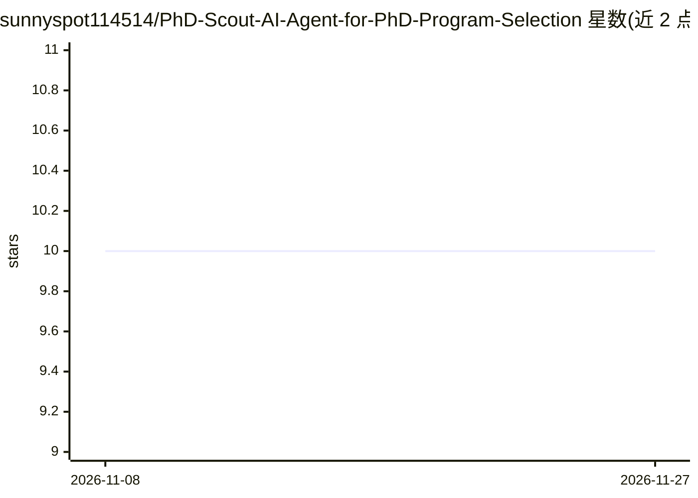

# sunnyspot114514/PhD-Scout-AI-Agent-for-PhD-Program-Selection

⭐ 10 · Python · MIT · 推送 2025-12-28 · [GitHub](https://github.com/sunnyspot114514/PhD-Scout-AI-Agent-for-PhD-Program-Selection) · 个人维护 · 中文 README

**面向 CS 博士申请者的 LLM 代理：筛选项目并分析研究匹配度**

AI 驱动的博士项目早期搜索与评估助手，覆盖三项任务：依据用户背景（GPA、论文、研究关键词）混合生成项目推荐，用 LLM 分析教师论文与研究关键词并输出 0-100 匹配分数及具体教授，自动核查 DET 语言考试接受度、资助政策等硬性条件。每条结论附带来源 URL 供人工复核。技术栈为 Python + LangChain + Streamlit，LLM 提供商可配置，提供 CLI 与 GUI 两种运行模式。

## 筛选速览

| 维度 | 判定 | 备注 |
|---|---|---|
| AI 角色 | `ai-native` | 本体是模型或模型工具 |
| 许可风险 | `permissive` | MIT |
| 部署形态 | `library` | 以包/库形式分发 |
| 模型依赖 | — | README 未给出锁定关系 |
| 硬件要求 | — | 无带数字的原话,不猜 |
| 安装摩擦 | `low` | 无编译、无系统依赖或容器化 |
| 成熟度 | — | 结构信号不足 |

## 能力要点

- LLM 分析教师论文与关键词，生成 Research Fit Score（0-100）并定位具体教授
- Google Search（Tavily）+ Semantic Scholar API 双源核验录取信息
- 自动核查 DET 接受度、资助政策、GPA 要求，每条结论附来源 URL
- 检测校友关联并按配置加分；CLI 与 Streamlit GUI 双模式

## 适用场景

- 按自身研究背景初筛数十上百个博士项目
- 批量核查语言考试接受度与资助政策等硬性条件
- 为短名单项目定位方向匹配的导师

## 场景标签

`科研工具` · 领域:学习与行业

## 证据(README 行号)

> L7: PhD-Scout is an AI-driven assistant designed to streamline the early-stage search and evaluation of Ph.D. programs.
> L51: * **Fit Scoring**: Uses LLM to analyze faculty papers against your keywords, generating a "Research Fit Score" (0–1

## 星数曲线

2026-11-08 10 → 2026-11-27 10（+0）

---
*卡片 v1 · prompt 1.4 · 生成 2026-11-19 · 置信度 high · 依据 README sha `285a64097617` · [字段定义](../../DATASET.md)*
