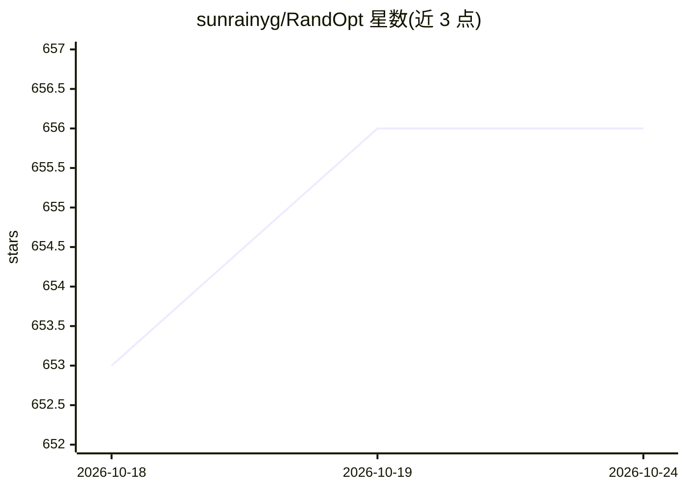

# sunrainyg/RandOpt

⭐ 656 · Python · 推送 2026-09-21 · [GitHub](https://github.com/sunrainyg/RandOpt) · 个人维护

**ICML 2026 论文 RandOpt 官方代码：围绕预训练权重的多样任务专家后训练方法**

论文 "Neural Thickets: Diverse Task Experts Are Dense Around Pretrained Weights"（Yulu Gan, Phillip Isola）的官方代码库，提出基于黑箱优化/神经进化的 LLM 后训练方法：围绕预训练权重生成多样化任务专家，支持蒸馏 top-k 模型为单一模型，并附基线对比。面向科研复现者，提供 pip 依赖安装、含 vLLM 的 Docker 镜像、Slurm 单/多节点与本地脚本；另在 iterative-randopt 分支提供可 pip 安装、嵌入 verl 或 huggingface/trl 的迭代版本。

## 筛选速览

| 维度 | 判定 | 备注 |
|---|---|---|
| AI 角色 | `ai-ecosystem` | LLM/agent 周边工具 |
| 许可风险 | `none` | — |
| 部署形态 | `self-host` | docker 或自建部署 |
| 模型依赖 | local-ok | 支持本地模型 |
| 硬件要求 | — | 无带数字的原话,不猜 |
| 安装摩擦 | `low` | 无编译、无系统依赖或容器化 |
| 成熟度 | — | 结构信号不足 |

## 能力要点

- 围绕预训练权重生成多样任务专家的后训练方法
- 支持将 top-k 模型蒸馏为单一模型
- 提供含 vLLM 的 Docker 镜像与 Slurm 单/多节点训练脚本
- iterative-randopt 分支提供可 pip 安装、嵌入 verl/TRL 的实现

## 适用场景

- 复现论文中的 LLM 后训练与蒸馏实验
- 在自己的数据集上用 RandOpt 方法后训练模型
- 将多个任务专家蒸馏为单一部署模型

## 场景标签

`科研工具` `微调` · 领域:学习与行业

## 证据(README 行号)

> L5: **Neural Thickets: Diverse Task Experts Are Dense Around Pretrained Weights**
> L34: ### Post-train on your own dataset
> L48: ## Distill top-k models into a single model

## 星数曲线

2026-10-18 653 → 2026-10-24 656（+3）

---
*卡片 v1 · prompt 1.4 · 生成 2026-10-21 · 置信度 mid · 依据 README sha `3fa0784cbead` · [字段定义](../../DATASET.md)*
