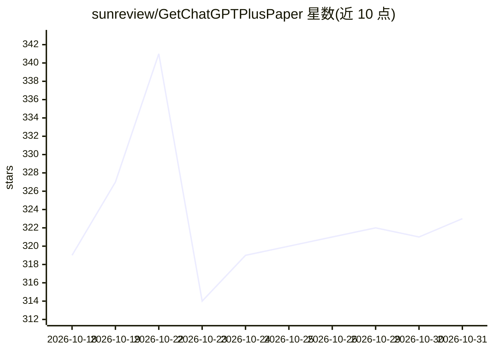

# sunreview/GetChatGPTPlusPaper

⭐ 323 · 推送 2026-10-30 · [GitHub](https://github.com/sunreview/GetChatGPTPlusPaper) · [官网](https://oksub.net/) · 个人维护 · 中文 README

**国内用户免国际信用卡充值 ChatGPT Plus 的图文视频教程**

面向已有自有 ChatGPT 账号但没有国际信用卡的中文用户，介绍通过发卡网购买充值卡密、在自助充值系统校验卡密、获取并粘贴账号 Access Token、解析账号并核对邮箱后提交升级的完整流程，共 10 步，附约 1 分钟视频演示。限制：仅适用 Free 状态账号，已是 Plus 的账号无法用此方式续费；提供 30 天订阅质保与微信客服渠道；教程提醒 Token 为敏感凭证。

## 筛选速览

| 维度 | 判定 | 备注 |
|---|---|---|
| AI 角色 | `ai-knowledge` | 知识聚合/清单类 |
| 许可风险 | `none` | — |
| 部署形态 | `None` |  |
| 模型依赖 | — | README 未给出锁定关系 |
| 硬件要求 | — | 无带数字的原话,不猜 |
| 安装摩擦 | `low` | 无编译、无系统依赖或容器化 |
| 成熟度 | — | 结构信号不足 |

## 能力要点

- 10 步卡密 + Token 自助充值流程，附视频演示
- 面向 Free 状态的自有账号升级，聊天记录保留
- 30 天订阅质保与微信客服支持
- 三语 README（中/英/俄）

## 适用场景

- 我没有国际信用卡，想给自己的 ChatGPT 账号升级 Plus
- 第一次充值，需要逐步截图教程对照操作
- 充值遇到卡密无效或未生效问题时按 FAQ 排查

## 场景标签

`教程课程` · 领域:学习与行业

## 证据(README 行号)

> L5: > 面向国内 / 中文用户的 **ChatGPT Plus 充值教程**：无需国际信用卡，用**卡密自助充值**给自己的 ChatGPT 账号**升级 Plus 订阅**。本文整理了从购买卡密、获取账号 Token、提交充值到确认 
> L73: 整个过程可以概括为：

## 星数曲线

2026-10-18 319 → 2026-10-31 323（+4）

---
*卡片 v1 · prompt 1.4 · 生成 2026-10-21 · 置信度 high · 依据 README sha `d3ea93720835` · [字段定义](../../DATASET.md)*
