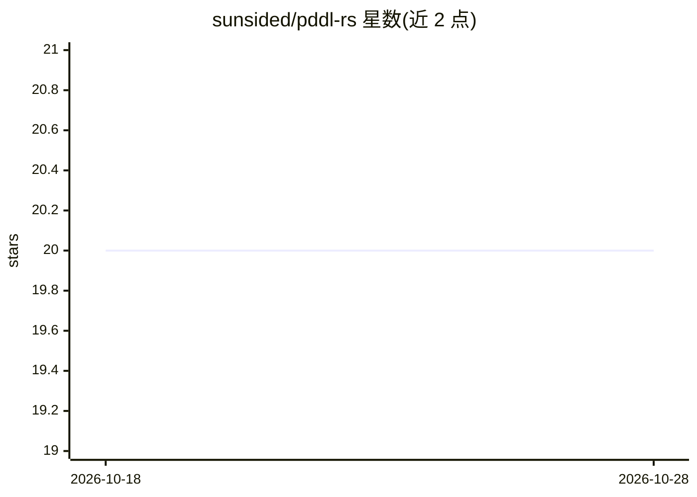

# sunsided/pddl-rs

⭐ 20 · Rust · EUPL-1.2 · 推送 2026-10-16 · [GitHub](https://github.com/sunsided/pddl-rs) · [官网](https://docs.rs/pddl/latest/pddl/) · 个人维护

**Rust 编写的 PDDL 3.1 解析库，供自动规划开发使用**

基于 nom 的 Planning Domain Definition Language 3.1 解析器，以 Rust crate 形式发布于 Crates.io 并提供 docs.rs 文档。支持解析 domain 与 problem 定义，可单文件解析多个 (define ...) 块；domain/problem 类型可独立于解析器使用，解析器通过 crate feature 默认启用、可关闭。解析器依据 Kovacs 的 PDDL 3.1 BNF 论文实现，文档注释汇编自 PDDL 论文与 planning-wiki。README 自述类型命名贴近 BNF，使用上可能不够顺手。

## 筛选速览

| 维度 | 判定 | 备注 |
|---|---|---|
| AI 角色 | `ai-ecosystem` | LLM/agent 周边工具 |
| 许可风险 | `viral` | EUPL-1.2 |
| 部署形态 | `library` | 以包/库形式分发 |
| 模型依赖 | — | README 未给出锁定关系 |
| 硬件要求 | — | 无带数字的原话,不猜 |
| 安装摩擦 | `low` | 无编译、无系统依赖或容器化 |
| 成熟度 | `idea` | |

## 能力要点

- 解析 PDDL 3.1 的 domain 与 problem 定义
- PddlFile 支持一次解析文件中多个 domain/problem 块
- domain/problem 类型可独立于解析器使用（parser feature 可关闭）
- 基于 Kovacs 的 PDDL 3.1 BNF 论文实现

## 适用场景

- 在 Rust 项目中解析 PDDL 领域与问题文件
- 构建自动规划（AI planning）相关工具时复用 PDDL 数据结构
- 按 BNF 元素核对 PDDL 3.1 语法支持情况

## 场景标签

 · 领域:AI 规划/开发库

## 证据(README 行号)

> L3: A parser for the Planning Domain Definition Language version 3.1: written in Rust, based on nom.
> L56: At this point the parser supports all domain and problem definition

## 星数曲线

2026-10-18 20 → 2026-10-28 20（+0）

---
*卡片 v1 · prompt 1.4 · 生成 2026-10-28 · 置信度 high · 依据 README sha `1e65a7d24795` · [字段定义](../../DATASET.md)*
