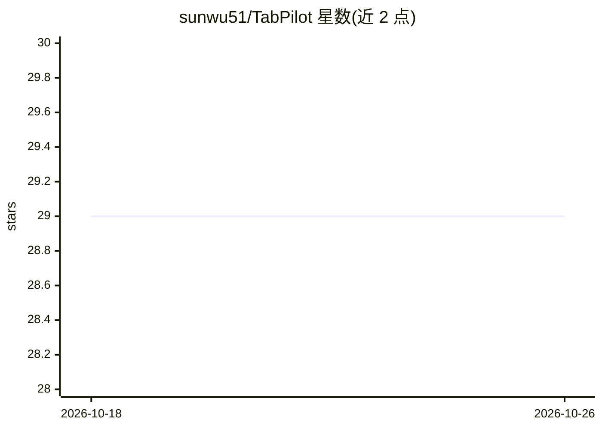

# sunwu51/TabPilot

⭐ 29 · JavaScript · 推送 2026-10-21 · [GitHub](https://github.com/sunwu51/TabPilot) · [官网](https://chromewebstore.google.com/detail/tab-manager/kklpijbnmbkpgcmnldimiagiehbakaec) · 个人维护 · 中文 README

**带 AI Agent 的 Chrome 标签页管理侧边栏扩展**

TabPilot 是一个 Chrome 侧边栏扩展，面向重度浏览器使用者：提供标签页搜索、按域名或自定义规则分组、工作区与标签暂存保存、设置导入导出及同步到 GitHub 仓库等标签管理功能。AI 部分为浏览器感知 Agent，可操作标签、窗口、历史、页面 DOM、截图与页面侧评估，支持连接 HTTP 或 Chrome 扩展形式的 MCP 工具，录制/回放宏并调度任务。从 Chrome Web Store 安装，LLM 需在设置中自行添加提供商。

## 筛选速览

| 维度 | 判定 | 备注 |
|---|---|---|
| AI 角色 | `ai-enhanced` | 去掉 AI 部分产品仍成立 |
| 许可风险 | `none` | — |
| 部署形态 | `library` | 以包/库形式分发 |
| 模型依赖 | — | README 未给出锁定关系 |
| 硬件要求 | — | 无带数字的原话,不猜 |
| 安装摩擦 | `low` | 无编译、无系统依赖或容器化 |
| 成熟度 | — | 结构信号不足 |

## 能力要点

- 浏览器感知 AI Agent：操作标签/窗口/历史/DOM/截图
- 支持接入 HTTP 与 Chrome 扩展形态的 MCP 工具，可经 WebSocket 暴露自身工具
- 宏录制回放、会话导出与定时工具任务
- 标签分组、工作区暂存与设置同步到 GitHub

## 适用场景

- 整理大量标签页并按域名/规则分组
- 让 AI Agent 在当前页面上代为执行浏览器操作
- 保存和恢复研究会话与工作区

## 场景标签

`浏览器自动化` · 领域:效率与自动化

## 证据(README 行号)

> L16: TabPilot is an AI-powered Chrome side panel for people who live in their browser. Put a browser-aware agent to work
> L18: It combines practical tab management with browser-aware AI tools — without making you leave the tab you are already
> L24: |✨ **Your browser-aware AI Agent**|Ask AI to work with tabs, windows, groups, history, page DOM actions, screenshot

## 星数曲线

2026-10-18 29 → 2026-10-26 29（+0）

---
*卡片 v1 · prompt 1.4 · 生成 2026-10-26 · 置信度 high · 依据 README sha `f42da6ae702f` · [字段定义](../../DATASET.md)*
