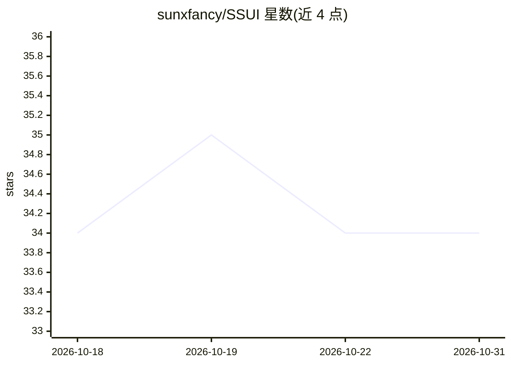

# sunxfancy/SSUI

⭐ 34 · Python · GPL-3.0 · 推送 2026-10-30 · [GitHub](https://github.com/sunxfancy/SSUI) · 个人维护 · 中文 README

**基于可复现 Python 脚本的生成式 AI 运行与分享平台**

Stable Scripts UI 是面向 Stable Scripts（一种 Python 脚本）的 Web/桌面界面：脚本自包含并自动下载所需模块与模型，脚本、依赖与 SSUI 本身均版本化，使他人可在相同环境中复现结果。提供项目管理系统、集中式模型管理（支持从 Civitai、HuggingFace 与本地文件下载）、Canvas/Functional UI/扩展等多种调用方式，以及编写脚本的 VSCode 插件。当前支持 SD1、SDXL、Flux 模型。开发环境需 nodejs/yarn 与 Rust 工具链，通过 yarn 命令安装与启动。

## 筛选速览

| 维度 | 判定 | 备注 |
|---|---|---|
| AI 角色 | `ai-native` | 本体是模型或模型工具 |
| 许可风险 | `viral` | GPL-3.0 |
| 部署形态 | `library` | 以包/库形式分发 |
| 模型依赖 | — | README 未给出锁定关系 |
| 硬件要求 | — | 无带数字的原话,不猜 |
| 安装摩擦 | `low` | 无编译、无系统依赖或容器化 |
| 成熟度 | — | 结构信号不足 |

## 能力要点

- Stable Scripts 自包含脚本自动下载所需模块、模型与数据
- 脚本/依赖/SSUI 版本化，保证结果可复现
- 集中式模型管理，支持 Civitai、HuggingFace 与本地模型
- 支持 SD1、SDXL、Flux，并提供 VSCode 插件

## 适用场景

- 编写并运行文生图等生成式工作流脚本
- 与他人分享项目并让对方复现相同生成结果
- 集中管理本地与在线来源的生成模型

## 场景标签

`图像生成` `视频生成` · 领域:内容生成

## 证据(README 行号)

> L5: Stable Scripts UI is a web-based user interface for `Stable Scripts` - a kind of python scripts can easily reproduce
> L76: def txt2img(model: SD1Model, positive: Prompt, negative: Prompt) -> Image:

## 星数曲线

2026-10-18 34 → 2026-10-31 34（+0）

---
*卡片 v1 · prompt 1.4 · 生成 2026-10-25 · 置信度 mid · 依据 README sha `3ae083c68ebb` · [字段定义](../../DATASET.md)*
