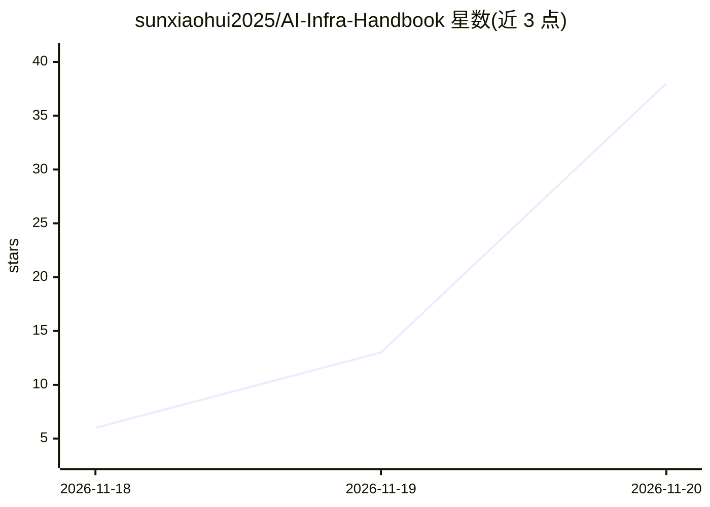

# sunxiaohui2025/AI-Infra-Handbook

⭐ 38 · MDX · 推送 2026-11-18 · [GitHub](https://github.com/sunxiaohui2025/AI-Infra-Handbook) · [官网](https://ai-infra-handbook.sunxiaohui2022.workers.dev/) · 个人维护 · 中文 README

**面向工程师的 LLM 推理基础设施交互式课程（153 讲）**

由大模型逐讲编写的 AI 基础设施课程，共 6 章 20 篇 153 讲，用 Astro 5 + MDX 建成静态网站，公式用 LaTeX 渲染，每讲嵌入可交互组件（显存计算器、Roofline 图、注意力动画等）。主线为数学基础→大模型基础→单机推理→分布式推理→推理引擎实践→芯模适配，附手写迷你推理引擎逐版实现与从零训练 GPT 的第 7 篇；支持在线阅读与 1342 页 PDF 下载，提供全局搜索与两条阅读路线。

## 筛选速览

| 维度 | 判定 | 备注 |
|---|---|---|
| AI 角色 | `ai-knowledge` | 知识聚合/清单类 |
| 许可风险 | `none` | — |
| 部署形态 | `library` | 以包/库形式分发 |
| 模型依赖 | — | README 未给出锁定关系 |
| 硬件要求 | — | 无带数字的原话,不猜 |
| 安装摩擦 | `medium` | 含编译或系统依赖之一 |
| 成熟度 | — | 结构信号不足 |

## 能力要点

- 6 章 20 篇 153 讲，136 主线讲 + 17 选读讲，31 讲标重点
- 每讲配可交互组件：显存账本计算器、通信代价 α-β 计算器、PagedAttention 块分配模拟器等
- 第 15 篇逐版手写迷你推理引擎（KV Cache→Continuous Batching→分页→量化→投机解码）
- 第 20 篇以海光 DCU 为案例读 vLLM 插件源码，覆盖非 NVIDIA 硬件适配

## 适用场景

- 系统学习 LLM 推理的显存、速度、成本工程账
- 为推理引擎开发或硬件适配补齐分布式与 kernel 基础
- 通过交互组件直观理解 KV Cache、张量并行、量化等机制

## 场景标签

`教程课程` · 领域:学习与行业

## 证据(README 行号)

> L34: 这是一套**由大模型逐讲编写**的 AI 基础设施（LLM 推理）课程，共 **6 章、20 篇、153 讲**，
> L35: 用 **Astro 5 + MDX** 建成一个可交互的静态网站：公式用 LaTeX 渲染，交互做成一个个可复用组件直接嵌进文章。
> L41: 章节主线：**数学基础 → 大模型基础 → 单机推理 → 分布式推理 → 推理引擎实践 → 芯模适配和调优**。

## 星数曲线

2026-11-18 6 → 2026-11-20 38（+32）

---
*卡片 v1 · prompt 1.4 · 生成 2026-11-19 · 置信度 high · 依据 README sha `b8d5020fd7b8` · [字段定义](../../DATASET.md)*
