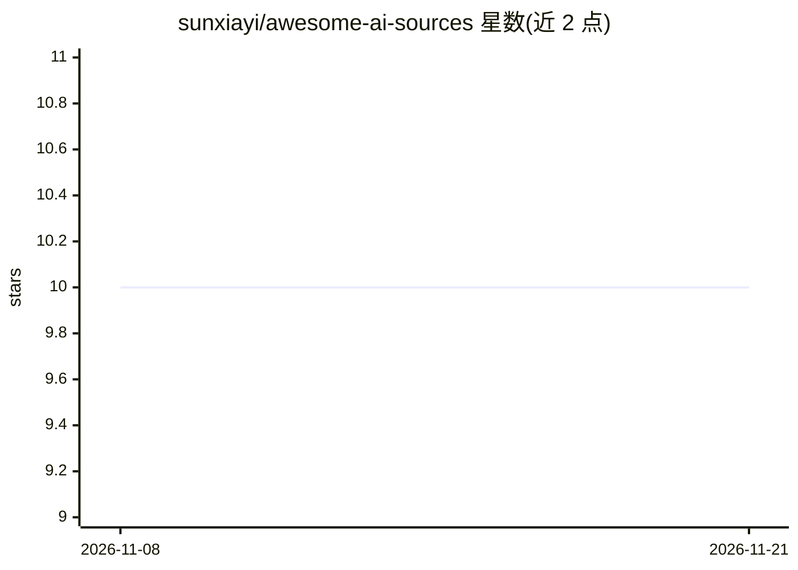

# sunxiayi/awesome-ai-sources

⭐ 10 · MIT · 推送 2026-11-09 · [GitHub](https://github.com/sunxiayi/awesome-ai-sources) · 个人维护

**面向 AI 使用者的高信号信息源策展目录与 RSS feed**

发布 Agentic Brew 产品背后的信息源清单：收录 1603 个公开来源，按公司/实验室、个人博客、AI 新闻分析站、研究 feed、社交账号五类组织，每周由人工审核更新。除 SOURCES.md 目录外，还通过 agenticbrew.ai 提供 11 个公共 RSS 2.0 feed（news/twitter/github/reddit/paper 等），任何 AI agent 或 RSS 阅读器无需认证即可拉取，并附一个可安装在 Claude Code 会话中的 ai-news-radar 插件，技能定义为单个 markdown 文件，仅依赖 Python stdlib。

## 筛选速览

| 维度 | 判定 | 备注 |
|---|---|---|
| AI 角色 | `ai-knowledge` | 知识聚合/清单类 |
| 许可风险 | `permissive` | MIT |
| 部署形态 | `None` |  |
| 模型依赖 | — | README 未给出锁定关系 |
| 硬件要求 | — | 无带数字的原话,不猜 |
| 安装摩擦 | `low` | 无编译、无系统依赖或容器化 |
| 成熟度 | — | 结构信号不足 |

## 能力要点

- 1603 个信息源，分 5 类组织，每周人工审核更新
- 11 个公共 RSS 2.0 feed，无认证、无调用方限流
- Claude Code 一行命令安装的 ai-news-radar 插件，支持斜杠命令与 JSON 输出
- 技能定义为自包含的 markdown 文件，可移植到其他 agent 框架

## 适用场景

- 让 AI coding agent 通过 RSS feed 拉取每日 AI 动态做成摘要
- 用 RSS 阅读器订阅 AI 论文、GitHub 仓库与 Product Hunt 发布
- 找值得关注的前沿实验室、研究者博客与社区账号

## 场景标签

`精选清单` · 领域:学习与行业

## 证据(README 行号)

> L9: This repository publishes the sources behind Agentic Brew: high-signal places to follow if you care about AI, fronti
> L71: Agentic Brew exposes the curated source content as public RSS feeds, so any AI coding agent (Claude Code, OpenClaw,

## 星数曲线

2026-11-08 10 → 2026-11-21 10（+0）

---
*卡片 v1 · prompt 1.4 · 生成 2026-11-19 · 置信度 high · 依据 README sha `62af3fb18377` · [字段定义](../../DATASET.md)*
