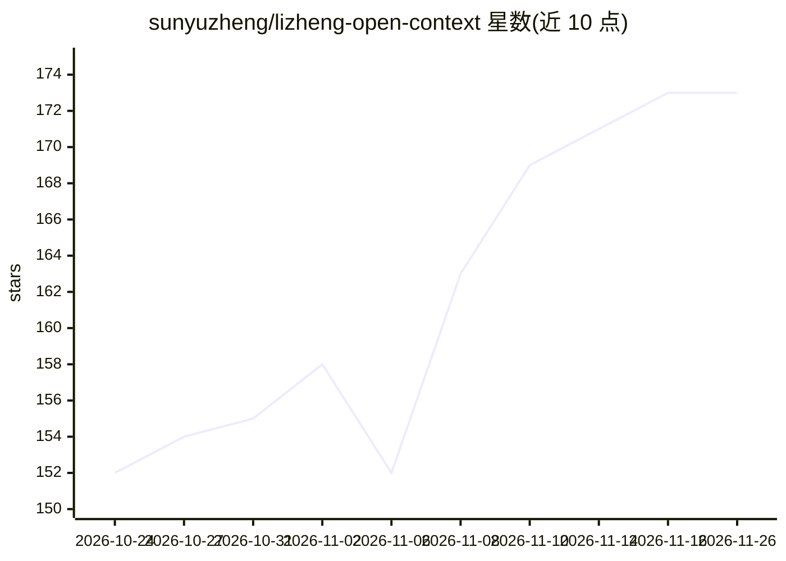

# sunyuzheng/lizheng-open-context

⭐ 173 · Python · NOASSERTION · 推送 2026-11-20 · [GitHub](https://github.com/sunyuzheng/lizheng-open-context) · [官网](https://www.superlinear.academy/community) · 个人维护 · 中文 README

**给人和 AI 提供立正公开原文的可检索引用资料库**

立正的公开资料仓库，以已发表原文与媒体为依据组织数据：corpus 保存文章、书籍文字、视频字幕与对谈原稿并保留作者、日期、时间码与质量字段，catalog 维护人物、节目与来源关系，context 存放 AI 整理的阅读地图与框架卡。内置本地搜索脚本，无需向量数据库即可检索，并给出接入 Agent 或其他产品的数据合同与引用协议。个人网站与问问立正消费同一份版本。

## 筛选速览

| 维度 | 判定 | 备注 |
|---|---|---|
| AI 角色 | `ai-knowledge` | 知识聚合/清单类 |
| 许可风险 | `none` | NOASSERTION |
| 部署形态 | `None` |  |
| 模型依赖 | — | README 未给出锁定关系 |
| 硬件要求 | — | 无带数字的原话,不猜 |
| 安装摩擦 | `low` | 无编译、无系统依赖或容器化 |
| 成熟度 | — | 结构信号不足 |

## 能力要点

- 结构化对谈原稿保留时间码、发言者与质量状态
- 本地搜索脚本输出原文片段、来源与时间点定位
- 提供数据合同与回答协议供接入其他产品
- 人物与来源目录支持按人物和来源发现资料

## 适用场景

- 检索并引用立正的文章、访谈与书籍原文
- 把资料库接入 Agent 或问答产品
- 按人物或节目浏览相关访谈与做客记录

## 场景标签

`知识库管理` · 领域:知识与检索

## 证据(README 行号)

> L3: 立正的公开资料库：以已发表的原文和媒体为依据，保存原文、精校文本，以及人物、节目和来源关系。给人和AI提供可检索、可引用、可继续开发的数据。个人网站与问问立正消费同一份版本。
> L13: |`context/`|AI整理的阅读地图、框架与判断卡|独立的提炼层，帮助阅读并回指原文|

## 星数曲线

2026-10-24 152 → 2026-11-26 173（+21）

---
*卡片 v1 · prompt 1.4 · 生成 2026-11-26 · 置信度 high · 依据 README sha `5e4d3a108b06` · [字段定义](../../DATASET.md)*
