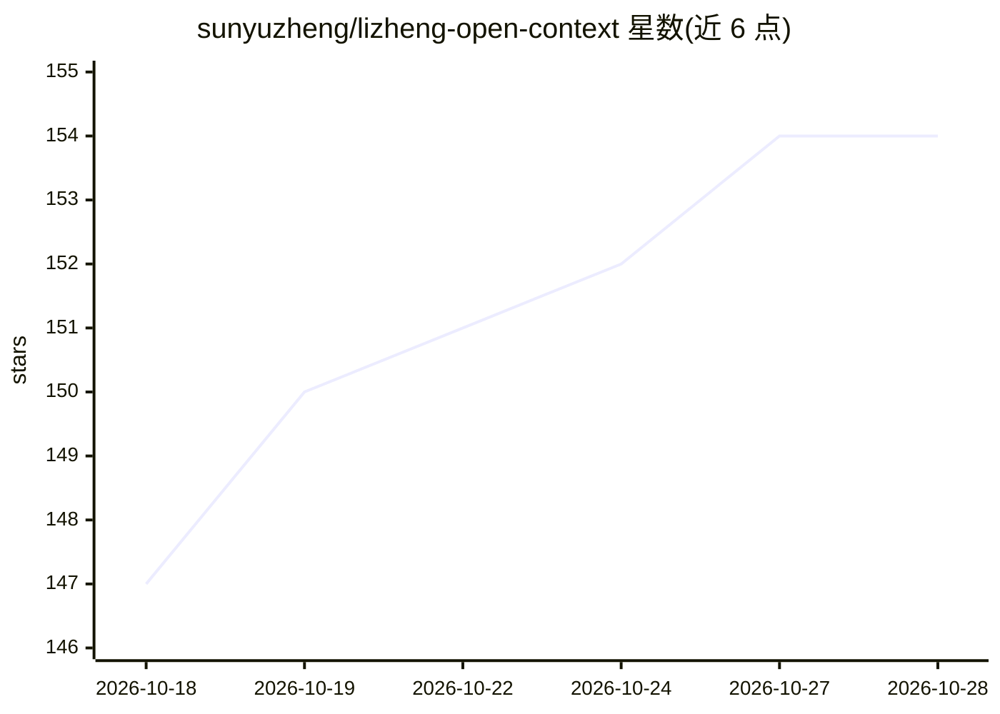

# sunyuzheng/lizheng-open-context

⭐ 154 · Python · NOASSERTION · 推送 2026-10-16 · [GitHub](https://github.com/sunyuzheng/lizheng-open-context) · [官网](https://www.superlinear.academy/community) · 个人维护 · 中文 README

**立正公开资料库：原文/字幕/提炼的可检索引用数据集**

围绕人物“立正”的公开资料仓库：收录已发表文章、书籍文字、视频精校字幕、对谈原稿与译稿，配套人物/节目/来源的结构化目录（catalog）、AI整理的阅读地图与判断卡（context），以及自动生成的索引。提供本地搜索脚本（无需向量数据库），结果带原文片段、来源、日期、归属与视频时间码；支持接入 Agent 等产品，个人网站与“问问立正”消费同一份数据。修改需本地校验后生成 release 发布。

## 筛选速览

| 维度 | 判定 | 备注 |
|---|---|---|
| AI 角色 | `ai-knowledge` | 知识聚合/清单类 |
| 许可风险 | `none` | NOASSERTION |
| 部署形态 | `None` |  |
| 模型依赖 | — | README 未给出锁定关系 |
| 硬件要求 | — | 无带数字的原话,不猜 |
| 安装摩擦 | `low` | 无编译、无系统依赖或容器化 |
| 成熟度 | — | 结构信号不足 |

## 能力要点

- 原文（corpus）、结构化目录（catalog）、AI提炼（context）、自动索引四层数据结构
- 本地搜索脚本按层级/类型检索，结果带来源、日期与时间码
- 结构化字幕保留时间码、发言者与质量字段，人物ID稳定
- release-manifest.json 固定文件版本，校验脚本保证可追溯

## 适用场景

- 为 AI Agent 或问答产品提供可引用的人物资料上下文
- 检索立正的文章、视频字幕与对谈原稿并定位到时间点
- 基于同一份数据构建个人网站或阅读导航

## 场景标签

`精选清单` · 领域:学习与行业

## 证据(README 行号)

> L3: 立正的公开资料库：以已发表的原文和媒体为依据，保存原文、精校文本，以及人物、节目和来源关系。给人和AI提供可检索、可引用、可继续开发的数据。个人网站与问问立正消费同一份版本。
> L13: |`context/`|AI整理的阅读地图、框架与判断卡|独立的提炼层，帮助阅读并回指原文|
> L26: 无需向量数据库，可先运行本地搜索：

## 星数曲线

2026-10-18 147 → 2026-10-28 154（+7）

---
*卡片 v1 · prompt 1.4 · 生成 2026-10-22 · 置信度 high · 依据 README sha `894c91108cbf` · [字段定义](../../DATASET.md)*
