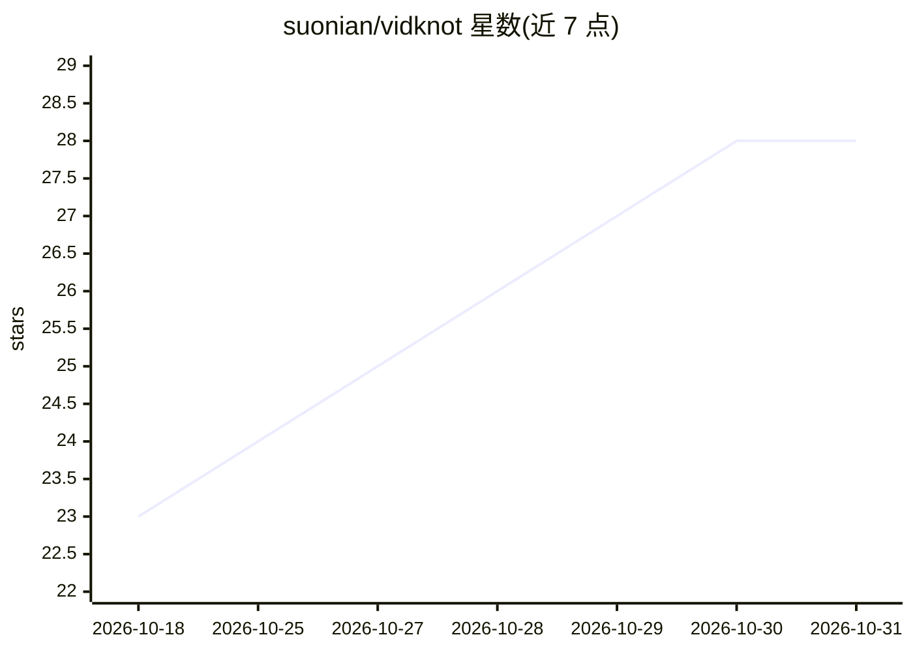

# suonian/vidknot

⭐ 28 · Python · MIT · 推送 2026-10-28 · [GitHub](https://github.com/suonian/vidknot) · 个人维护 · 中文 README

**从 11+ 视频平台提取转写并生成结构化笔记的命令行工具**

VidkNot 是一个视频知识提取流水线：从 YouTube、B 站、抖音、小红书等 11+ 平台解析视频并下载音频（抖音有四层 fallback），用 SiliconFlow SenseVoice 与本地 faster-whisper 双 ASR 交叉校验转写，再由 OpenAI 兼容 LLM 生成含主题、要点、引用、术语的结构化 Markdown 笔记，可保存到 Obsidian、飞书、Notion、语雀。以 pip 安装的 Python 工具提供，支持 CLI、Python API、FastAPI 与 MCP 四种接入方式。运行需 FFmpeg（可用 bundled-ffmpeg 可选依赖替代），笔记生成需配置 OpenAI 兼容 API Key。

## 筛选速览

| 维度 | 判定 | 备注 |
|---|---|---|
| AI 角色 | `ai-native` | 本体是模型或模型工具 |
| 许可风险 | `permissive` | MIT |
| 部署形态 | `library` | 以包/库形式分发 |
| 模型依赖 | — | README 未给出锁定关系 |
| 硬件要求 | — | 无带数字的原话,不猜 |
| 安装摩擦 | `medium` | 含编译或系统依赖之一 |
| 成熟度 | — | 结构信号不足 |

## 能力要点

- 双 ASR（SiliconFlow SenseVoice + 本地 faster-whisper）交叉校验转写
- 11+ 平台解析与下载，抖音四层 fallback
- 生成含主题/要点/引用/术语/时间戳转写的结构化 Markdown 笔记
- 提供 CLI、Python API、FastAPI、MCP 四种使用方式

## 适用场景

- 把课程、访谈、播客视频整理成可检索的文字笔记
- 将短视频内容沉淀到 Obsidian、飞书、Notion、语雀知识库
- 给 Agent / MCP 客户端提供视频转笔记工具能力

## 场景标签

`知识库管理` `语音识别` `AI 写作` · 领域:内容生成

## 证据(README 行号)

> L50: |双 ASR 转写|SiliconFlow SenseVoice + 本地 faster-whisper，默认启用交叉校正|
> L51: |结构化笔记|生成主题、要点、细节、引用、术语和完整转写|

## 星数曲线

2026-10-18 23 → 2026-10-31 28（+5）

---
*卡片 v1 · prompt 1.4 · 生成 2026-10-27 · 置信度 high · 依据 README sha `6b77b5631ff5` · [字段定义](../../DATASET.md)*
