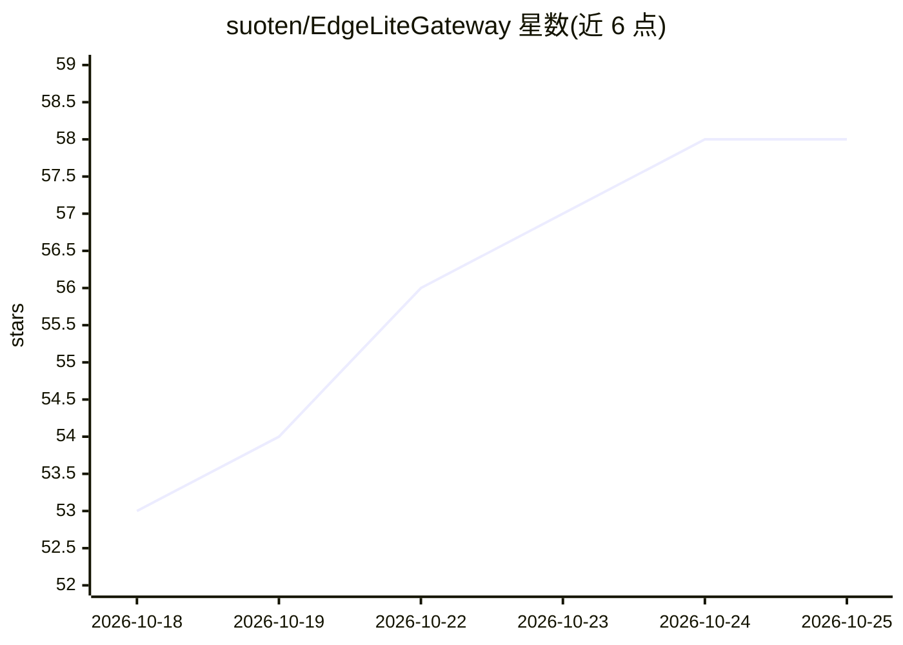

# suoten/EdgeLiteGateway

⭐ 58 · Python · NOASSERTION · 推送 2026-10-14 · [GitHub](https://github.com/suoten/EdgeLiteGateway) · 个人维护 · 中文 README

**给工业物联网开发者：开源边缘AI网关，采集+ONNX推理+视觉确认**

面向工业物联网场景的 Python 边缘 AI 网关（FastAPI + Vue 前端），覆盖 13 种南向工业协议采集（Modbus/S7/OPC UA/MQTT 等）、6 个北向平台对接、规则引擎与流计算。AI 部分：内置 ONNX Runtime 推理引擎（延迟 < 100ms），提供异常检测、趋势预测、动态阈值 3 个可本地自学习的预置模型，支持传感器异常后调取摄像头做视觉 AI 二次确认，另有 MCP Server 供 Agent 查询设备状态。提供 Docker Compose 部署（约 10 分钟）与 Python 本地开发模式；另存在 Go 社区版（单二进制）与付费企业版（高可用、国密合规等）。

## 筛选速览

| 维度 | 判定 | 备注 |
|---|---|---|
| AI 角色 | `ai-native` | 本体是模型或模型工具 |
| 许可风险 | `none` | NOASSERTION |
| 部署形态 | `desktop` | 安装包/桌面程序 |
| 模型依赖 | — | README 未给出锁定关系 |
| 硬件要求 | — | 无带数字的原话,不猜 |
| 安装摩擦 | `low` | 无编译、无系统依赖或容器化 |
| 成熟度 | `idea` | |

## 能力要点

- 13 种工业协议采集（Modbus TCP/RTU、S7、MC、FINS、CIP、OPC UA/DA、MQTT、ONVIF 等）
- ONNX Runtime 边缘推理引擎，3 个可自学习预置模型（异常检测/趋势预测/动态阈值）
- 传感器 AI + 视觉 AI 双确认告警链路
- 内置规则引擎、告警关联、断网 SQLite 缓存与多网关级联

## 适用场景

- 在工控机或边缘盒子本地完成设备数据采集与 AI 异常检测
- 用视觉 AI 交叉验证传感器告警，降低误报
- 数据不出厂、断网可用的边缘智能监控场景

## 场景标签

`推理引擎` · 领域:训练与推理

## 证据(README 行号)

> L41: EdgeLite Gateway 是一个面向工业物联网场景的**开源边缘AI网关**。它不是传统网关——只搬运数据；而是在边缘侧完成**设备数据采集 → AI实时推理 → 视频联动确认**的完整闭环，让边缘节点真正会"思考"。
> L196: - **ONNX Runtime 推理引擎**：原生支持 `.onnx` 模型，边缘侧实时推理，单次延迟 < 100ms，最大并发 4
> L205: - **传感器AI + 视觉AI 双确认**：传感器异常 → AI确认 → 调取摄像头 → 视觉AI二次确认 → 高置信告警

## 星数曲线

2026-10-18 53 → 2026-10-25 58（+5）

---
*卡片 v1 · prompt 1.4 · 生成 2026-10-24 · 置信度 high · 依据 README sha `a3f68bf86eed` · [字段定义](../../DATASET.md)*
