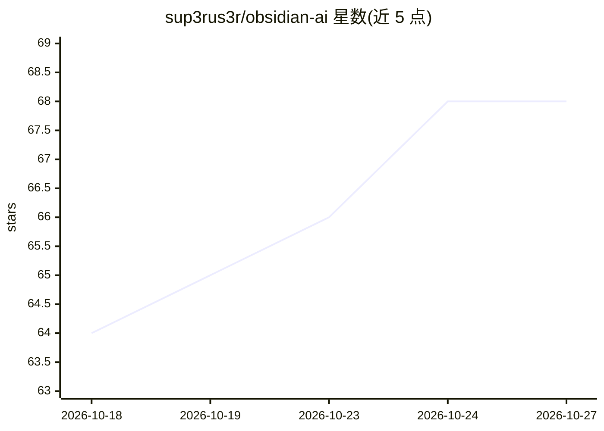

# sup3rus3r/obsidian-ai

⭐ 68 · Python · AGPL-3.0 · 推送 2026-10-23 · [GitHub](https://github.com/sup3rus3r/obsidian-ai) · 个人维护

**可视化 AI Agent 构建与编排平台，自托管**

开源的 AI Agent 管理与编排平台：通过 Web 可视化界面创建 Agent、多 Agent 团队（Coordinate/Route/Collaborate 三种协作模式）与工作流，提供拖拽式 DAG 编辑器、Cron 定时调度、n8n 工作流导入、MCP 协议接入外部工具、人机协同审批、知识库 RAG 与 Artifact 产物面板。支持 OpenAI、Anthropic、Google、Ollama、OpenRouter 及任意 OpenAI 兼容端点。技术栈为 Python/FastAPI + Next.js/React，AGPL v3 许可，自托管部署。面向不愿编写 SDK 胶水代码的开发者与团队用户。

## 筛选速览

| 维度 | 判定 | 备注 |
|---|---|---|
| AI 角色 | `ai-ecosystem` | LLM/agent 周边工具 |
| 许可风险 | `viral` | AGPL-3.0 |
| 部署形态 | `self-host` | docker 或自建部署 |
| 模型依赖 | local-ok | 支持本地模型 |
| 硬件要求 | — | 无带数字的原话,不猜 |
| 安装摩擦 | `low` | 无编译、无系统依赖或容器化 |
| 成熟度 | — | 结构信号不足 |

## 能力要点

- 多 LLM 供应商接入：OpenAI/Anthropic/Google/Ollama/OpenRouter/OpenAI 兼容端点，供应商切换无需改配置
- 可视化 DAG 工作流编辑器：并行执行、节点状态实时追踪、循环检测、Cron 调度
- MCP 原生支持（Stdio/SSE 传输）与逐 Agent 绑定外部工具
- 安全机制：JWT 认证、TOTP 2FA、AES 端到端加密、RBAC、PII 脱敏隐私模式

## 适用场景

- 在自托管环境里搭建多 Agent 协作团队处理客服、研究、内容生成等任务
- 用拖拽画布编排顺序或并行工作流并定时自动运行
- 从 n8n 迁移已有自动化工作流到 Agent 架构

## 场景标签

`多智能体` `工作流自动化` `Agent 框架` `RAG` · 领域:Agent 开发

## 证据(README 行号)

> L5: Build, deploy, and orchestrate AI agents, multi-agent teams, and automated workflows - all from one unified control 
> L27: Most AI agent frameworks are code-only libraries that require deep programming knowledge. **Obsidian AI** provides 
> L30: - **Visual orchestration** - Create multi-agent teams, sequential pipelines, and parallel DAG workflows from a drag

## 星数曲线

2026-10-18 64 → 2026-10-27 68（+4）

---
*卡片 v1 · prompt 1.4 · 生成 2026-10-24 · 置信度 mid · 依据 README sha `4ac8e58eb534` · [字段定义](../../DATASET.md)*
