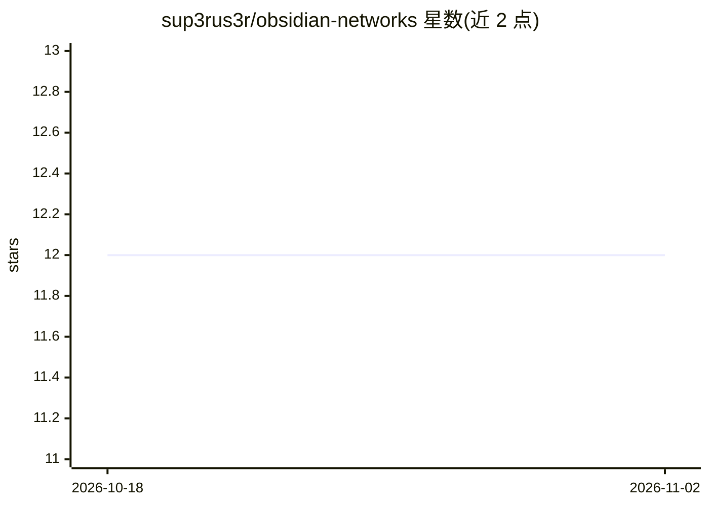

# sup3rus3r/obsidian-networks

⭐ 12 · Python · AGPL-3.0 · 推送 2026-08-24 · [GitHub](https://github.com/sup3rus3r/obsidian-networks) · 个人维护

**自然语言描述问题即自动产出可用 ML 模型的本地平台**

开源平台，用户用自然语言描述 ML 问题后，由 LLM agent 完成文献检索（arXiv）、方案规划（带引用）、代码生成、训练与调试，输出训练好的模型与可修改的 Jupyter notebook。全程在本机硬件运行，数据不出机器。附加 Research Labs 模块：八个专职 agent 跨多代循环执行开放式架构搜索（生成候选、tensor-optix 训练、评分、迭代）。支持视觉/文本/时序/图等九个领域。需自选 LLM provider。

## 筛选速览

| 维度 | 判定 | 备注 |
|---|---|---|
| AI 角色 | `ai-native` | 本体是模型或模型工具 |
| 许可风险 | `viral` | AGPL-3.0 |
| 部署形态 | `self-host` | docker 或自建部署 |
| 模型依赖 | — | README 未给出锁定关系 |
| 硬件要求 | — | 无带数字的原话,不猜 |
| 安装摩擦 | `low` | 无编译、无系统依赖或容器化 |
| 成熟度 | — | 结构信号不足 |

## 能力要点

- 问题→文献→计划→训练的端到端自动 ML 流水线
- Research Labs 八 agent 多代架构搜索，评分含新颖性/效率/健全性/泛化
- tensor-optix 训练循环：SPSA 在线超参调优、退化回滚、自动 checkpoint
- 基于 Anthropic Agent Skills 标准的手写技能库积累领域知识

## 适用场景

- 没有 ML 经验的人用一段话描述需求获得可训练模型
- 研究者在指定领域做多代架构搜索实验
- 本地环境完成文献检索到模型交付的全流程

## 场景标签

`科研工具` `模型训练` · 领域:学习与行业

## 证据(README 行号)

> L3: Obsidian Networks is an open-source platform that takes a problem described in plain language and builds a working M
> L5: You describe the problem. It handles the rest: literature search, architecture selection, code generation, training,

## 星数曲线

2026-10-18 12 → 2026-11-02 12（+0）

---
*卡片 v1 · prompt 1.4 · 生成 2026-10-31 · 置信度 high · 依据 README sha `83753a203b40` · [字段定义](../../DATASET.md)*
