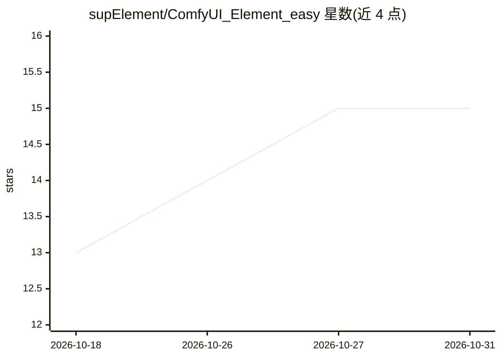

# supElement/ComfyUI_Element_easy

⭐ 15 · JavaScript · Apache-2.0 · 推送 2026-10-29 · [GitHub](https://github.com/supElement/ComfyUI_Element_easy) · 个人维护 · 中文 README

**给 ComfyUI 用户的可视化交互节点集：剪辑、素材管理与调色**

以可视化交互为主要方向的 ComfyUI 自定义节点包，包含约 20 多个节点：单轨视频剪辑器（PySceneDetect 自动分镜、时间线手动剪辑、mp4 导出需 ffmpeg）、面向多参考输入视频模型（MiniMax-H3、LTXV、Wan 等）的 21 槽位素材与提示词管理面板、曲线调色四件套、自绘 sigma 采样曲线、可视化扩图与智能拼图等图像编辑工具。通过 ComfyUI Manager 或 git clone 安装；部分功能依赖较新 ComfyUI 版本与可选的 ffmpeg/scenedetect。

## 筛选速览

| 维度 | 判定 | 备注 |
|---|---|---|
| AI 角色 | `ai-ecosystem` | LLM/agent 周边工具 |
| 许可风险 | `permissive` | Apache-2.0 |
| 部署形态 | `library` | 以包/库形式分发 |
| 模型依赖 | — | README 未给出锁定关系 |
| 硬件要求 | — | 无带数字的原话,不猜 |
| 安装摩擦 | `medium` | 含编译或系统依赖之一 |
| 成熟度 | — | 结构信号不足 |

## 能力要点

- Element Load and Edit Video：节点内可视化视频剪辑，自动分镜与音频同步预览
- Element Multi REF：21 类型化槽位管理参考图/视频/首尾帧/音频，预设可批量队列运行
- 曲线调色系列：曲线直接画在图像上实时预览，支持序列帧
- Smart merge images 与可视化扩图节点，配合图像编辑模型使用

## 适用场景

- 在 ComfyUI 工作流中不切换软件完成视频剪辑与素材准备
- 为多参考视频模型批量管理分镜脚本的提示词与素材
- 给生图/图像编辑模型的输出做曲线调色、扩图与分块拼回

## 场景标签

`图像视频处理` `提示工程` · 领域:Agent 开发

## 证据(README 行号)

> L6: 一个以**可视化界面、方便交互**为主要方向的 ComfyUI 扩展。这个包里的节点不太一样：不是一个滑杆配一个数字，而是把完整的小工具直接搬进了节点里。
> L66: 为 MiniMax-H3、LTXV、Wan、Klein、Qwen 等需要多路参考输入的视频/图像模型设计的素材及提示词管理方案：

## 星数曲线

2026-10-18 13 → 2026-10-31 15（+2）

---
*卡片 v1 · prompt 1.4 · 生成 2026-10-30 · 置信度 mid · 依据 README sha `7108f202eb07` · [字段定义](../../DATASET.md)*
