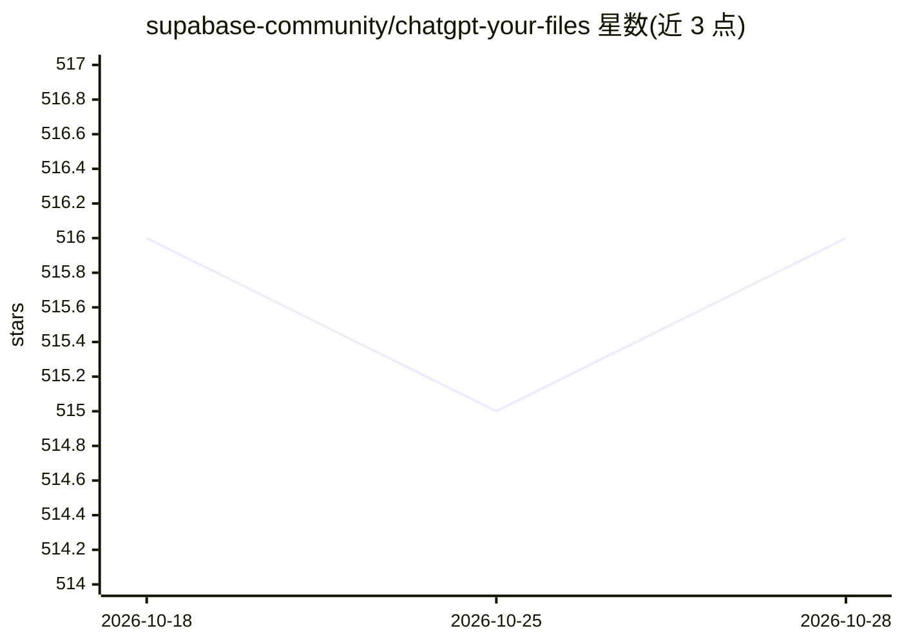

# supabase-community/chatgpt-your-files

⭐ 516 · TypeScript · 推送 2026-05-12 · [GitHub](https://github.com/supabase-community/chatgpt-your-files) · [官网](https://youtu.be/ibzlEQmgPPY) · 组织维护

**教学工坊：用 Supabase+pgvector 搭建安全文档对话 MVP**

由 Supabase 社区维护的分步工坊项目，指导开发者用 Next.js、Supabase（存储/认证/Edge Functions）与 pgvector 构建可安全对话自己文档的 RAG 应用。内容按 git tag 分步检查点组织：对象存储上传与 RLS 策略、markdown 按标题切分入库、384 维 embedding 与 HNSW 索引、通过 pg_net 触发 Edge Function 处理文档。附带 YouTube 录播与 3 个示例文件。前提为 Unix/WSL2、Docker、Node.js 18+。

## 筛选速览

| 维度 | 判定 | 备注 |
|---|---|---|
| AI 角色 | `ai-knowledge` | 知识聚合/清单类 |
| 许可风险 | `none` | — |
| 部署形态 | `library` | 以包/库形式分发 |
| 模型依赖 | — | README 未给出锁定关系 |
| 硬件要求 | — | 无带数字的原话,不猜 |
| 安装摩擦 | `low` | 无编译、无系统依赖或容器化 |
| 成熟度 | — | 结构信号不足 |

## 能力要点

- 按 git tag 检查点拆解的 6 步工坊流程
- pgvector embedding(384) + HNSW 索引的 RAG 管道
- 存储/表级行级安全（RLS）与 18 种第三方登录集成
- pg_net 触发器 + Deno Edge Function 处理新上传文档

## 适用场景

- 跟着工坊学习用 pgvector 构建生产级 RAG 应用
- 了解 Supabase 存储、认证与 Edge Functions 的组合用法
- 搭建可安全对话私有文档的 Next.js 原型

## 场景标签

`RAG` `教程课程` · 领域:知识与检索

## 证据(README 行号)

> L1: pgvector to Prod in 2 hours
> L4: Create a production-ready MVP for securely chatting with your documents.
> L20: ## 📄 Workshop Instructions

## 星数曲线

2026-10-18 516 → 2026-10-28 516（+0）

---
*卡片 v1 · prompt 1.4 · 生成 2026-10-21 · 置信度 mid · 依据 README sha `8e5b87b67d83` · [字段定义](../../DATASET.md)*
