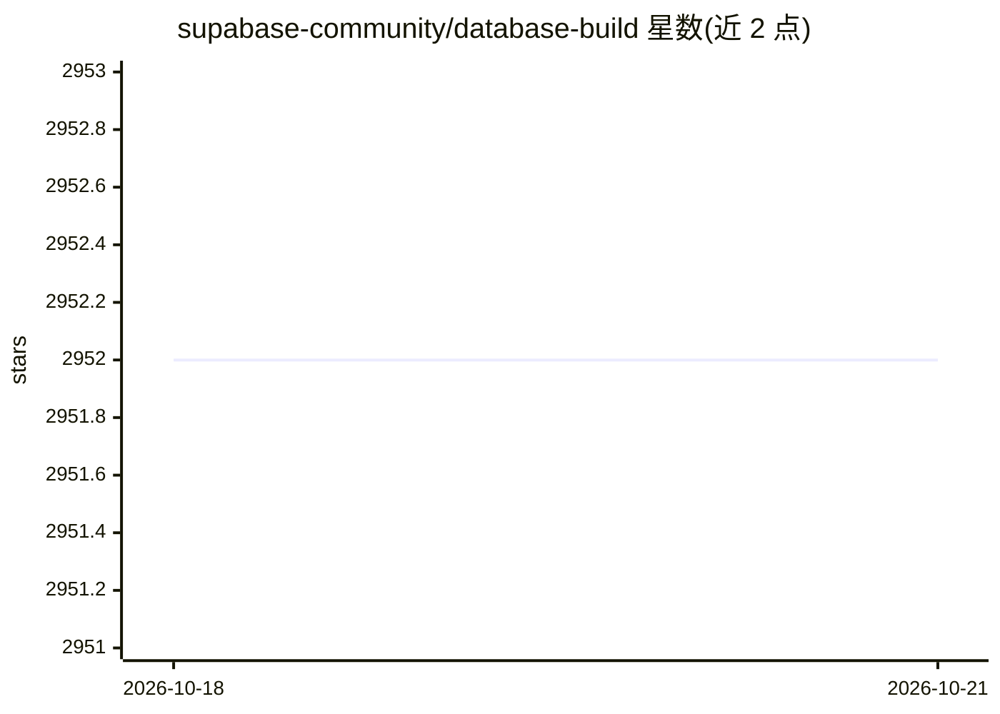

# supabase-community/database-build

⭐ 2,952 · TypeScript · Apache-2.0 · 推送 2026-06-03 · [GitHub](https://github.com/supabase-community/database-build) · [官网](https://database.build) · 组织维护

**浏览器内 Postgres 沙箱，配 LLM 辅助建库与生成报表**

基于 PGlite（WASM 版 Postgres）在浏览器中直接运行的去中心化数据库沙箱：无需远程容器或 WebSocket 代理，可即时创建数量不限的 Postgres 实例，数据存于 IndexedDB。每个数据库配对一个 LLM，支持拖拽导入 CSV 自动生成表、生成导出报表、生成图表、构建数据库关系图。Monorepo 含 Next.js 主应用、浏览器 TCP 代理与部署 worker（当前支持部署到 Supabase）。面向开发者，本地运行需 OpenAI API key、本地 Supabase 栈与 Redis。

## 筛选速览

| 维度 | 判定 | 备注 |
|---|---|---|
| AI 角色 | `ai-enhanced` | 去掉 AI 部分产品仍成立 |
| 许可风险 | `permissive` | Apache-2.0 |
| 部署形态 | `self-host` | docker 或自建部署 |
| 模型依赖 | — | README 未给出锁定关系 |
| 硬件要求 | — | 无带数字的原话,不猜 |
| 安装摩擦 | `low` | 无编译、无系统依赖或容器化 |
| 成熟度 | — | 结构信号不足 |

## 能力要点

- PGlite 使 Postgres 直接运行在浏览器，数据持久化于 IndexedDB
- LLM 配对：CSV 拖拽建表、报表与图表生成、数据库关系图
- 可将浏览器内数据库部署到 Supabase 等平台

## 适用场景

- 在浏览器中快速试验 Postgres 查询与表结构
- 导入 CSV 让 AI 自动生成表并产出报表图表
- 把沙箱中的数据库部署到 Supabase

## 场景标签

`数据分析` · 领域:效率与自动化

## 证据(README 行号)

> L3: In-browser Postgres sandbox with AI assistance.
> L9: Each database is paired with a large language model (LLM) which opens the door to some interesting use cases:
> L20: How is this possible? PGlite, a WASM version of Postgres that can run directly in your browser. Every database that

## 星数曲线

2026-10-18 2,952 → 2026-10-21 2,952（+0）

---
*卡片 v1 · prompt 1.4 · 生成 2026-10-21 · 置信度 mid · 依据 README sha `c90163cf3547` · [字段定义](../../DATASET.md)*
