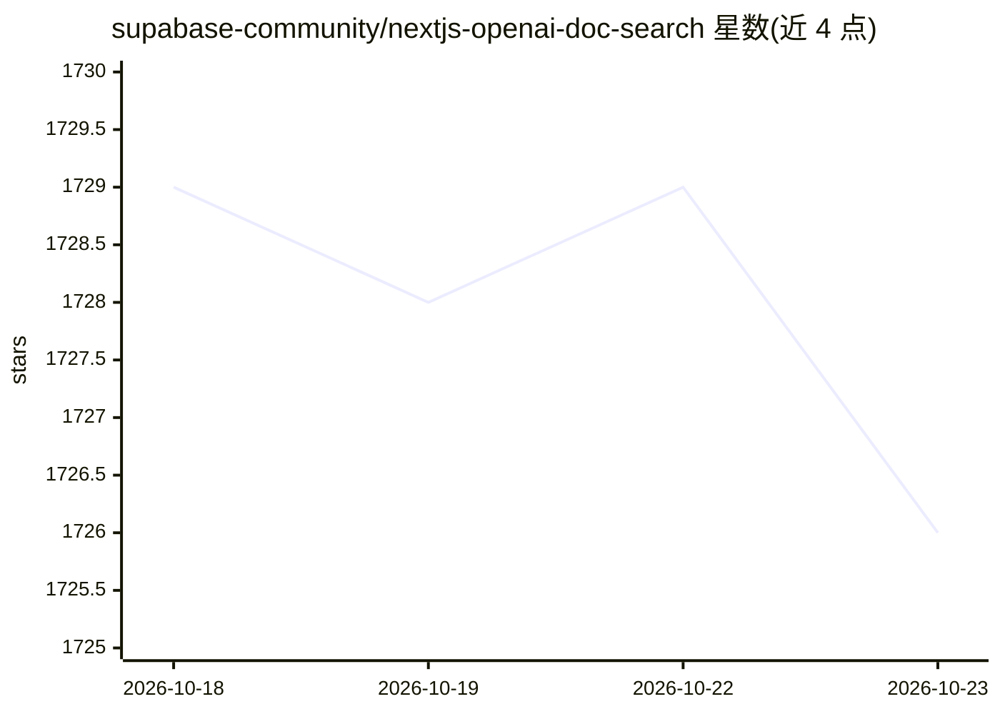

# supabase-community/nextjs-openai-doc-search

⭐ 1,726 · TypeScript · Apache-2.0 · 推送 2026-05-12 · [GitHub](https://github.com/supabase-community/nextjs-openai-doc-search) · [官网](https://supabase.com/blog/chatgpt-supabase-docs) · 组织维护

**基于 Next.js+OpenAI+Supabase 的文档问答搜索模板**

由 Supabase 社区维护的 ChatGPT 式文档搜索起步模板：构建时读取 pages 目录下的 .mdx 文件生成嵌入并存入 Postgres（pgvector），用 checksum 避免未变更文件重复生成；运行时通过向量相似度检索相关内容，注入 OpenAI GPT-3 文本补全提示词并流式返回。支持一键部署到 Vercel，本地开发需 Docker 运行 Supabase 并配置 OPENAI_KEY，供开发者搭建自有文档站问答搜索。

## 筛选速览

| 维度 | 判定 | 备注 |
|---|---|---|
| AI 角色 | `ai-ecosystem` | LLM/agent 周边工具 |
| 许可风险 | `permissive` | Apache-2.0 |
| 部署形态 | `None` |  |
| 模型依赖 | — | README 未给出锁定关系 |
| 硬件要求 | — | 无带数字的原话,不猜 |
| 安装摩擦 | `low` | 无编译、无系统依赖或容器化 |
| 成熟度 | — | 结构信号不足 |

## 能力要点

- 构建时将 .mdx 文件生成嵌入存入 Postgres（pgvector）
- checksum 机制仅在文件变更时重新生成嵌入
- 运行时向量相似度检索并注入 OpenAI GPT-3 提示词流式响应
- 支持 Vercel 一键部署，Supabase 集成自动配置环境变量与数据库结构

## 适用场景

- 为我的文档站搭建 ChatGPT 式问答搜索
- 基于自有 .mdx 文档构建带出处的智能搜索
- 学习 pgvector 嵌入检索与 Edge Function 的实现方式

## 场景标签

 · 领域:Web 开发/文档检索（RAG）

## 证据(README 行号)

> L3: This starter takes all the `.mdx` files in the `pages` directory and processes them to use as custom context within 
> L13: Building your own custom ChatGPT involves four steps:
> L17: 3. [🏃 Runtime] Perform vector similarity search to find the content that's relevant to the question.

## 星数曲线

2026-10-18 1,729 → 2026-10-23 1,726（-3）

---
*卡片 v1 · prompt 1.4 · 生成 2026-10-21 · 置信度 high · 依据 README sha `4744166829dc` · [字段定义](../../DATASET.md)*
