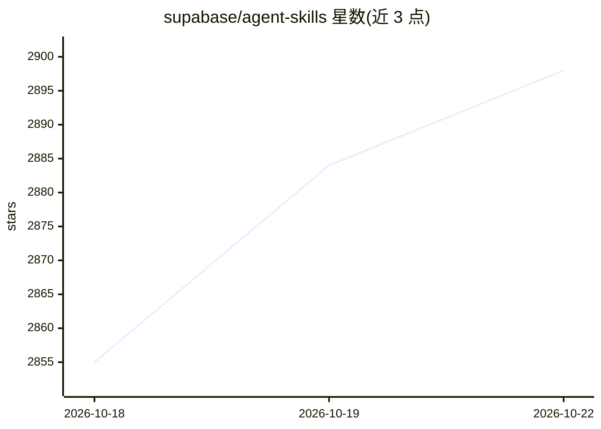

# supabase/agent-skills

⭐ 2,898 · TypeScript · MIT · 推送 2026-10-02 · [GitHub](https://github.com/supabase/agent-skills) · [官网](https://supabase.com/docs/guides/getting-started/ai-skills) · 组织维护

**给 AI 开发者的 Supabase 技能包：指令与参考文档助 agent 用好 Supabase**

Supabase 官方维护的 Agent Skills 集合：以 SKILL.md 清单加参考文档的文件夹形式，为 AI agent 提供使用 Supabase 产品与 Postgres 的指令和资源。包含两个技能：supabase（覆盖数据库、Auth、Edge Functions、客户端库等）与 supabase-postgres-best-practices（按 8 类组织的 Postgres 性能优化指南）。兼容 Claude Code、GitHub Copilot、Cursor 等 18 种 agent，通过 npx 或 Claude Code 插件市场安装，安装后 agent 在相关任务中自动调用。

## 筛选速览

| 维度 | 判定 | 备注 |
|---|---|---|
| AI 角色 | `ai-ecosystem` | LLM/agent 周边工具 |
| 许可风险 | `permissive` | MIT |
| 部署形态 | `library` | 以包/库形式分发 |
| 模型依赖 | — | README 未给出锁定关系 |
| 硬件要求 | — | 无带数字的原话,不猜 |
| 安装摩擦 | `low` | 无编译、无系统依赖或容器化 |
| 成熟度 | — | 结构信号不足 |

## 能力要点

- 遵循 Agent Skills 开放标准（SKILL.md + references 结构）
- supabase 技能覆盖全产品线及 supabase-js/SSR 集成
- supabase-postgres-best-practices 含 8 类按影响力排序的性能指南
- 发布 .well-known/index.json（schema v0.2.0）供 supabase.com 分发

## 适用场景

- 让 AI agent 帮我优化 Postgres 查询或审查 schema
- 在 Claude Code / Cursor 等工具中获得 Supabase Auth 与 SSR 集成指导
- 为 agent 补充 Supabase CLI 与 MCP server 的使用知识

## 场景标签

`提示工程` · 领域:Agent 开发

## 证据(README 行号)

> L5: Agent Skills to help developers using AI agents with Supabase. Agent Skills are
> L7: to do things more accurately and efficiently. Compatible with 18+ AI agents
> L21: npx skills add supabase/agent-skills

## 星数曲线

2026-10-18 2,855 → 2026-10-22 2,898（+43）

---
*卡片 v1 · prompt 1.4 · 生成 2026-10-21 · 置信度 high · 依据 README sha `8d6db4886452` · [字段定义](../../DATASET.md)*
