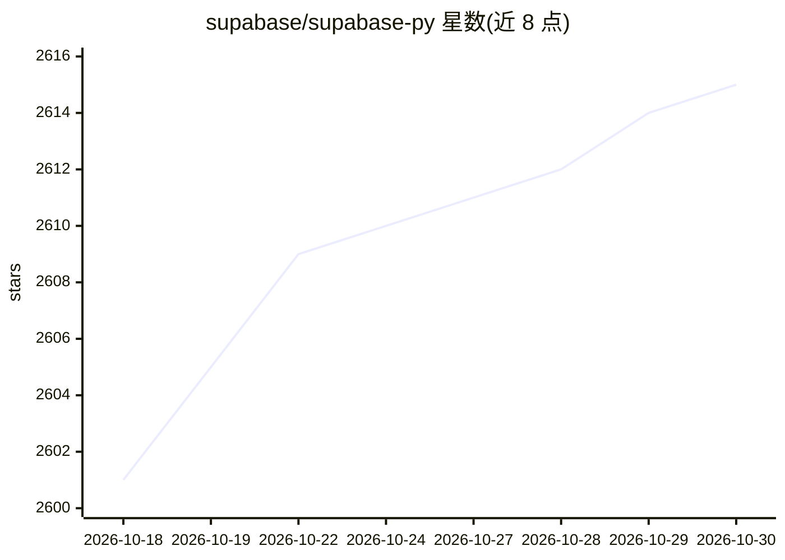

# supabase/supabase-py

⭐ 2,615 · Python · MIT · 推送 2026-10-29 · [GitHub](https://github.com/supabase/supabase-py) · [官网](https://supabase.com/docs/reference/python) · 组织维护

**Supabase 官方 Python 客户端 monorepo：数据库、认证、存储、实时**

Supabase 各 Python 库的 monorepo，包含 supabase 主客户端、realtime-py、supabase_functions、storage3、postgrest、supabase_auth 六个子包，覆盖 Postgres 查询、用户认证、Edge Functions 调用、文件存储与实时数据流，可在 Flask、Django、FastAPI 中使用。开发依赖 uv、make、docker 与 supabase-cli（用于测试容器），支持 nix 环境；测试通过 make ci 并行调度各子包。README 仅覆盖本地开发流程，未展示最终用户安装命令。

## 筛选速览

| 维度 | 判定 | 备注 |
|---|---|---|
| AI 角色 | `ai-ecosystem` | LLM/agent 周边工具 |
| 许可风险 | `permissive` | MIT |
| 部署形态 | `None` |  |
| 模型依赖 | — | README 未给出锁定关系 |
| 硬件要求 | — | 无带数字的原话,不猜 |
| 安装摩擦 | `medium` | 含编译或系统依赖之一 |
| 成熟度 | — | 结构信号不足 |

## 能力要点

- 六个子包覆盖数据库、认证、存储、实时、Edge Functions
- 支持 Flask/Django/FastAPI 集成（GitHub OAuth、数据加载示例）
- uv 工作区 + make + docker 测试容器的开发流程，支持 nix

## 适用场景

- 在 Flask/Django/FastAPI 项目中查询 Postgres 与管理用户认证
- Python 应用接入 Supabase 存储、实时数据流与 Edge Functions
- 为 Supabase 各 Python 子包贡献代码与运行测试

## 场景标签

 · 领域:后端服务/数据库 SDK

## 证据(README 行号)

> L7: Python monorepo for all Supabase libraries.
> L9: - supabase

## 星数曲线

2026-10-18 2,601 → 2026-10-30 2,615（+14）

---
*卡片 v1 · prompt 1.4 · 生成 2026-10-21 · 置信度 mid · 依据 README sha `d7956f195503` · [字段定义](../../DATASET.md)*
