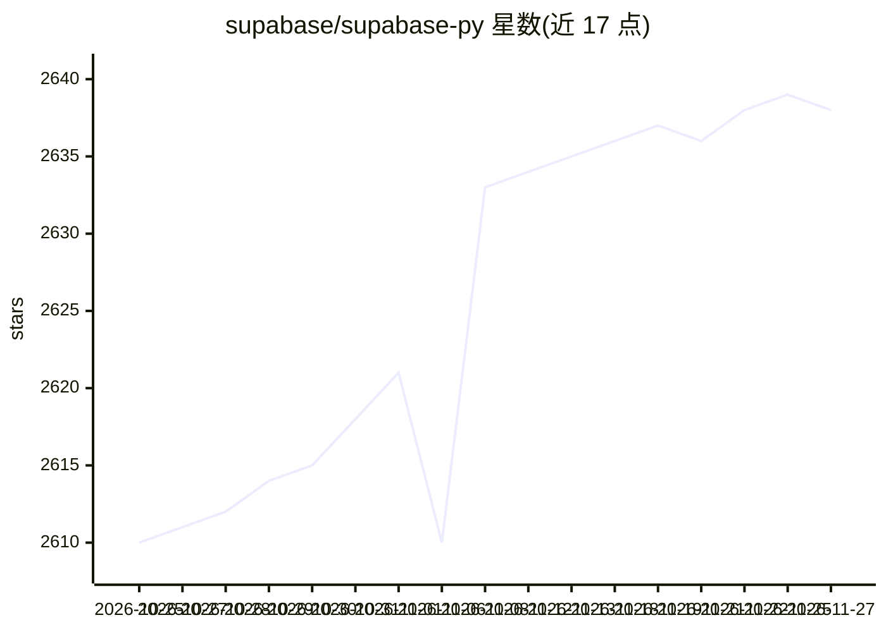

# supabase/supabase-py

⭐ 2,638 · Python · MIT · 推送 2026-11-26 · [GitHub](https://github.com/supabase/supabase-py) · [官网](https://supabase.com/docs/reference/python) · 组织维护

**Supabase 官方 Python 客户端：在 Python 中查询 Postgres 与调用各服务**

Supabase 的 Python 单仓库（monorepo），包含 supabase、realtime、supabase_functions、storage3、postgrest、supabase_auth、supabase_utils 七个子包，供 Flask/Django/FastAPI 应用访问 Postgres、用户认证、文件存储、边缘函数与实时数据流。仅保证与各 Supabase 服务最新版本兼容，仅官方支持 CPython，支持 Python 3.12 及未到生命周期终点的后续版本。本地开发依赖 uv、make、supabase-cli 与 docker 测试容器。

## 筛选速览

| 维度 | 判定 | 备注 |
|---|---|---|
| AI 角色 | `ai-ecosystem` | LLM/agent 周边工具 |
| 许可风险 | `permissive` | MIT |
| 部署形态 | `None` |  |
| 模型依赖 | — | README 未给出锁定关系 |
| 硬件要求 | — | 无带数字的原话,不猜 |
| 安装摩擦 | `medium` | 含编译或系统依赖之一 |
| 成熟度 | `idea` | |

## 能力要点

- monorepo 包含 7 个子包：认证、存储、PostgREST、Realtime、边缘函数等
- 支持 Python 3.12 及未到 EOL 的后续版本，仅在 Linux 上测试、支持任意 CPython 平台
- 仅保证与各 Supabase 服务最新发布版本兼容

## 适用场景

- 在 Flask/Django/FastAPI 后端中通过 Python 访问 Supabase 的 Postgres 数据
- 在 Python 应用中集成用户认证、文件存储与实时数据流
- 自托管 Supabase 时配合 SDK 升级各服务版本

## 场景标签

 · 领域:开发工具/数据库客户端

## 证据(README 行号)

> L7: Python monorepo for all Supabase libraries.
> L14: - supabase
> L26:  - GitHub OAuth in your Python Flask app

## 星数曲线

2026-10-25 2,610 → 2026-11-27 2,638（+28）

---
*卡片 v1 · prompt 1.4 · 生成 2026-11-23 · 置信度 high · 依据 README sha `54dfeb543847` · [字段定义](../../DATASET.md)*
