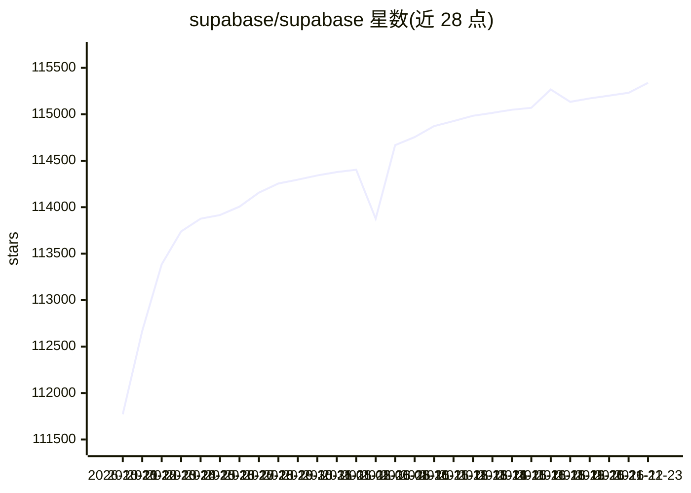

# supabase/supabase

⭐ 115,339 · TypeScript · Apache-2.0 · 推送 2026-11-22 · [GitHub](https://github.com/supabase/supabase) · [官网](https://supabase.com) · 组织维护 · 中文 README

**给开发者提供托管/自托管 Postgres 的开发平台**

以 Postgres 为核心的开发平台，整合 Realtime（websocket 订阅数据库变更）、PostgREST（自动生成 REST API）、pg_graphql（GraphQL API）、GoTrue（JWT 认证）、Storage（文件存储）、Edge Functions 等开源组件，并提供仪表盘。平台以托管方式使用无需安装，也可自托管和本地开发。提供多语言客户端库（JS/TS、Flutter、Swift、Python、C#、Go、Java、Kotlin、Ruby、Rust、GDScript），含 AI 向量/嵌入工具包（pgvector）。

## 筛选速览

| 维度 | 判定 | 备注 |
|---|---|---|
| AI 角色 | `ai-enhanced` | 去掉 AI 部分产品仍成立 |
| 许可风险 | `permissive` | Apache-2.0 |
| 部署形态 | `None` |  |
| 模型依赖 | — | README 未给出锁定关系 |
| 硬件要求 | — | 无带数字的原话,不猜 |
| 安装摩擦 | `low` | 无编译、无系统依赖或容器化 |
| 成熟度 | — | 结构信号不足 |

## 动量与使用信号

- 维护:`active` — 距上次 push 0.6 天,年发版 8,398 位贡献者
- 涨星:近 1 天 **+58**(自 20261016 起算)

## 能力要点

- 托管或自托管的 Postgres 数据库与自动生成 REST/GraphQL API
- Realtime 组件通过 websocket 广播数据库插入/更新/删除
- 基于 JWT 的 GoTrue 认证与会话管理
- AI + 向量/嵌入工具包（pgvector）与文件存储

## 适用场景

- 为 Web 和移动应用提供数据库、认证与 API 后端
- 自托管一套 Firebase 式后端开发环境
- 在 Postgres 中结合 pgvector 构建向量/嵌入应用

## 场景标签

 · 领域:后端开发平台/数据库

## 证据(README 行号)

> L3: Supabase is the Postgres development platform. We're building the features of Firebase using enterprise-grade open s
> L15: - [x] AI + Vector/Embeddings Toolkit. Docs

## 星数曲线

2026-10-21 111,771 → 2026-11-23 115,339（+3,568）

---
*卡片 v1 · prompt 1.4 · 生成 2026-11-22 · 置信度 high · 依据 README sha `d22825d94dec` · [字段定义](../../DATASET.md)*
