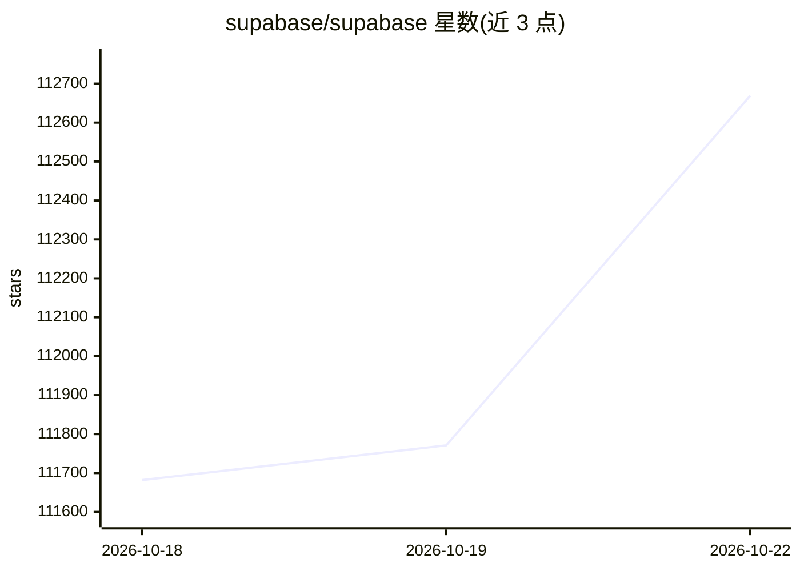

# supabase/supabase

⭐ 112,669 · TypeScript · Apache-2.0 · 推送 2026-10-21 · [GitHub](https://github.com/supabase/supabase) · [官网](https://supabase.com) · 组织维护

**给 Web/移动/AI 应用开发者提供 Postgres 后端开发平台**

基于 Postgres 的开发平台，将数据库、认证授权、自动生成 API、实时订阅、函数、文件存储与向量嵌入工具集组合为一体化后端。架构由 PostgREST、GoTrue、Realtime、Storage、pg_graphql 等开源组件构成。提供托管平台（注册即用）与自托管/本地开发两种方式；官方客户端库覆盖 JavaScript、Flutter、Swift、Python、Kotlin 等，并有 C#、Go、Java、Ruby、Rust、Godot 等社区库。README 未列出安装命令与硬件要求。

## 筛选速览

| 维度 | 判定 | 备注 |
|---|---|---|
| AI 角色 | `ai-ecosystem` | LLM/agent 周边工具 |
| 许可风险 | `permissive` | Apache-2.0 |
| 部署形态 | `None` |  |
| 模型依赖 | — | README 未给出锁定关系 |
| 硬件要求 | — | 无带数字的原话,不猜 |
| 安装摩擦 | `low` | 无编译、无系统依赖或容器化 |
| 成熟度 | — | 结构信号不足 |

## 动量与使用信号

- 维护:`active` — 距上次 push 0.6 天,年发版 8,398 位贡献者
- 涨星:近 1 天 **+58**(自 20261016 起算)

## 能力要点

- 托管 Postgres 数据库与认证授权、REST/GraphQL 自动生成 API
- Realtime 通过 websocket 广播数据库变更（基于 Elixir 服务器）
- AI + Vector/Embeddings Toolkit 与 pg_graphql 扩展
- 多语言官方客户端库（JS/Flutter/Swift/Python/Kotlin 等）

## 适用场景

- 为 Web 或移动应用搭建带认证与实时功能的 Postgres 后端
- 为 AI 应用存储和检索向量嵌入
- 自托管一套开源的 Firebase 类后端服务
- 用 Edge Functions 编写服务端逻辑

## 场景标签

`向量数据库` · 领域:知识与检索

## 证据(README 行号)

> L3: Supabase is the Postgres development platform. We're building the features of Firebase using enterprise-grade open s
> L15: - [x] AI + Vector/Embeddings Toolkit. Docs
> L43: Supabase is a hosted platform. You can sign up and start using Supabase without installing anything.

## 星数曲线

2026-10-18 111,682 → 2026-10-22 112,669（+987）

---
*卡片 v1 · prompt 1.4 · 生成 2026-10-18 · 置信度 high · 依据 README sha `73a471ddb228` · [字段定义](../../DATASET.md)*
